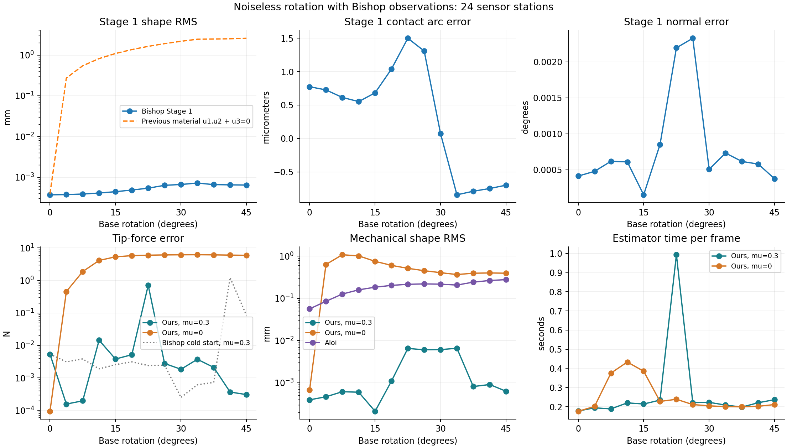

# Bishop-observation base-rotation comparison

Date: 2026-10-07. Branch: codex/two-stage-force-sensing. Local changes only; no commit or push.

## Scope and observation contract

The physical reference is the preserved, independently solved 0-45 degree axial base-rotation trajectory, at 18 mm insertion, with world-fixed plane and tip force [1,0,-1] N. True friction is 0.3. There are 13 quasistatic frames and 24 noiseless geometric sensor stations. No finite-radius contact torque, tip contact, or edge/corner geometry was added. This is an ideal geometric sensor benchmark, not a validation of the experimental FBGS software's twist compensation.

The sensor outputs w1,w2 defined by t'=w1*b1+w2*b2, with B(base)=R(base). Full material strain u is converted outside the estimator using psi'=u3 and w=R2(psi)[u2,-u1]. Reference conversion uses the unchanged upstream forward map at 0.1 mm output spacing, retaining the same physical forces, contact arcs and actuation. The estimator receives only sampled w, calibrated rod/environment inputs and actuation. It never receives true twist, forces, contact arcs or dense truth positions. The saved MAT contains input and truth separately for scoring.

Stage 1 integrates Bishop angular strain [-w2,w1,0]. Piecewise PCHIP is confined to calibrated intrinsic/stiffness segments, preserving the known 120 mm intrinsic-curvature transition without using the unknown contact arc. No material intrinsic vector is incorrectly subtracted from a Bishop vector. Each calibrated segment currently requires at least two sensor stations. This adapter targets the existing piecewise calibrated rod model; it should not treat an arbitrary smoothly varying calibration as a collection of sparse discontinuities.

Stage 2 retains full material mechanics, adds a scalar psi state and its analytic sensitivities, and compares predicted Bishop curvature with measured Bishop curvature. The likelihood, force priors, complementarity projections and semismooth SQP retain the previous tolerances. The zero-mu run changes assumed friction only. Aloi's original algorithm is unchanged and receives sparse positions reconstructed from the exact same Bishop measurements.

## Results, including every frame

Force entries are RMS Euclidean force errors across frames; shape entries combine all rod nodes and frames. Timing is the second complete deterministic replay for our methods.

| Quantity | Ours mu=0.3 | Ours mu=0 | Aloi |
|---|---:|---:|---:|
| Contact force RMSE (N) | 0.220472 | 9.907535 | Not separated |
| Tip force RMSE (N) | 0.197113 | 5.129309 | Not separated |
| Total force RMSE (N) | 0.036394 | 5.164771 | 1.484979 |
| Shape RMS (mm) | 0.003539 | 0.604589 | 0.199043 |
| Seconds/frame | 0.2715 | 0.2512 | 8.2245 |
| Stage 1 seconds/frame | 0.1300 | 0.1299 | Shared reconstruction preparation |
| Mechanics seconds/frame | 0.1392 | 0.1187 | Included above |
| SQP iterations/frame | 7.62 | 6.31 | Different solver |
| Full-rod IVPs/frame | 16.62 | 13.92 | No shooting IVP |
| Segmented ODE calls/frame | 49.85 | 41.77 | Different integration |
| RHS evaluations/frame | 6498.9 | 5672.1 | Different integration |
| Converged optimizer frames | 13/13 | 13/13 | 10/13 positive exits |

At 45 degrees, correct-mu tip error is 0.000305 N and contact error 0.000373 N. Estimated tip force is [1.000290, 0.000088, -1.000035] N.



## Stage 1 accuracy

Across all frames, Stage 1 shape RMS is 0.00055043 mm; maximum per-frame RMS is 0.00071933 mm. Maximum absolute contact-arc error is 0.00149843 mm, maximum normal error 0.00232957 degrees, and maximum contact-point position error 0.00280323 mm. Stage 1 results are identical for both assumed friction coefficients.

At 45 degrees, shape RMS is 0.00064248 mm, tip position error 0.00252965 mm, arc error -0.00069823 mm, and normal error 0.00037325 degrees. Previous Stage 1 shape RMS was 2.588135 mm. The integration refinement table holds the same 24 measurements fixed; remaining error includes sparse interpolation and kinematic discretization. No contact truth is used to correct it.

## Initialization ablation and failures

Simply changing the observations/residual while retaining the old per-frame linear seed gives 12/13 converged frames, tip RMSE 0.340583 N and shape RMS 0.476461 mm. Failed angles: [41.25]. This replay is preserved as cold_frames.csv and cold.mat; its 41.25-degree failure occurs despite accurate Stage 1 geometry and propagates into the next frame's mechanical history.

The final run uses the preceding converged material state as a numerical start when contacts match. This avoids repeatedly interpreting a Bishop frame as a measured material frame. First-frame/unmatched initialization remains the old approximate linear seed. This is a starting-point correction: it does not change the MAP objective, tolerances, measurements or diagnostics, and is controlled by bishopWarmStart. The no-extra-within-step-loop design is retained. Final failed angles: mu=0.3 []; mu=0 [].

A same-history diagnostic isolates the remaining outlier: at 22.5 degrees the recurrent seed returns objective 404.06 and tip error 0.71048 N, whereas the linear seed reaches objective 16.814 and tip error 0.002391 N using the same observations, geometry and preceding state. At 41.25 degrees the recurrent seed succeeds, while the linear seed fails. This establishes initialization/globalization sensitivity, not an irreducible geometric error or proof of a second physical solution. The 22.5-degree outlier remains in all headline metrics; no automatic restart or result substitution was introduced. See same_history_initialization.csv. A more reliable initialization/globalization policy remains future work.

Correct-mu flag counts: {'positive-friction-work': 2, 'fbg-mismatch': 1}. Zero-mu flag counts: {'fbg-mismatch': 12, 'active-contact-tangency': 9, 'penetration': 7}. Maximum correct-mu inferred-plane penetration: 5.64485e-07 mm; maximum projection residual: 9.42133e-07 N. Maximum positive modeled friction work: 1.78647e-08 N mm. Flags are preserved, not suppressed: the work warning uses a stricter near-zero threshold than the force projection tolerance and must be interpreted with the reported slip/projection values. The reconstructed environment differs slightly from the true plane: true-plane penetration is recorded separately in ours_frames.csv and must not be confused with feasibility against the inferred plane. All detailed physics, solver failures and iteration traces are published. A converged flag does not certify accuracy under the deliberately incorrect mu=0 model.

The previous material-observation run had tip/contact RMSE 0.610493/0.824851 N and 11/13 converged frames. Improvements combine the intended geometric observation model and the explicitly reported initialization correction; the cold replay isolates the former.

## Solver settings and validation

MATLAB geometry MAP: lsqnonlin trust-region-reflective, max 30 iterations, function/step tolerance 1e-8, optimality 1e-6. Mechanics: existing semismooth SQP with active-set quadprog, max 60 iterations, stationarity 1e-05, moment 1e-05 N mm, projection 1e-06 N, gap 1e-05 mm. ODE relative/absolute coefficients: 2e-08/2e-10, with the existing state scaling. No injected sensor or environment noise; the curvature likelihood retains the declared standard deviation 1e-06/mm. Environment priors retain 0.03 mm point-component and 0.001 normal-component standard deviations, despite noiseless mean observations.

The analytic Bishop observation Jacobian agrees with finite differences to relative error 1.39e-10. An independent analytic helix reconstructs within 8.13e-06 mm on the test grid. The independent forward truth predicts sensor measurements within 7.27e-10/mm and positions within 6.25e-09 mm. Rigid-world-rotation invariance passes. Existing core and spatial derivative tests pass. Repeated numerical outcomes agree to 0. All 196 hashed collaborator-source/previous-published files are unchanged.

Aloi mean winning-start iterations: 18.38; separate profiling counts 3331.31 shape integrations/frame. Final equilibrium checks pass 13/13. Unprofiled sequence time is 106.9186 s plus 0.0195 s preparation; profiling overhead is excluded. Comparisons use different integration schemes and warmup histories, so timings are descriptive rather than a controlled hardware speedup claim.

## Reproduction

From the package directory, with the previous physical reference available:

```matlab
setenv('TSFS_RUN_ID','base_rotation_bishop_20261007'); setup_tsfs;
prepare_bishop_rotation;
test_bishop; test_tsfs; test_spatial_derivatives;
run_bishop_rotation('cold');
run_bishop_rotation('ours');
run_bishop_rotation('aloi');
run_bishop_rotation('profile');
analyze_bishop_rotation;
diagnose_bishop_initialization;
```

Then run `python experiments/base_rotation/summarize_bishop_rotation.py`. The previous base_rotation_20261006 benchmark and single_contact_mu_20261006 benchmark are preserved. The forward physical friction-sensitivity results remain applicable to the unchanged truth; the old inverse-sensitivity results belong to the old observation model and are not reused here.
