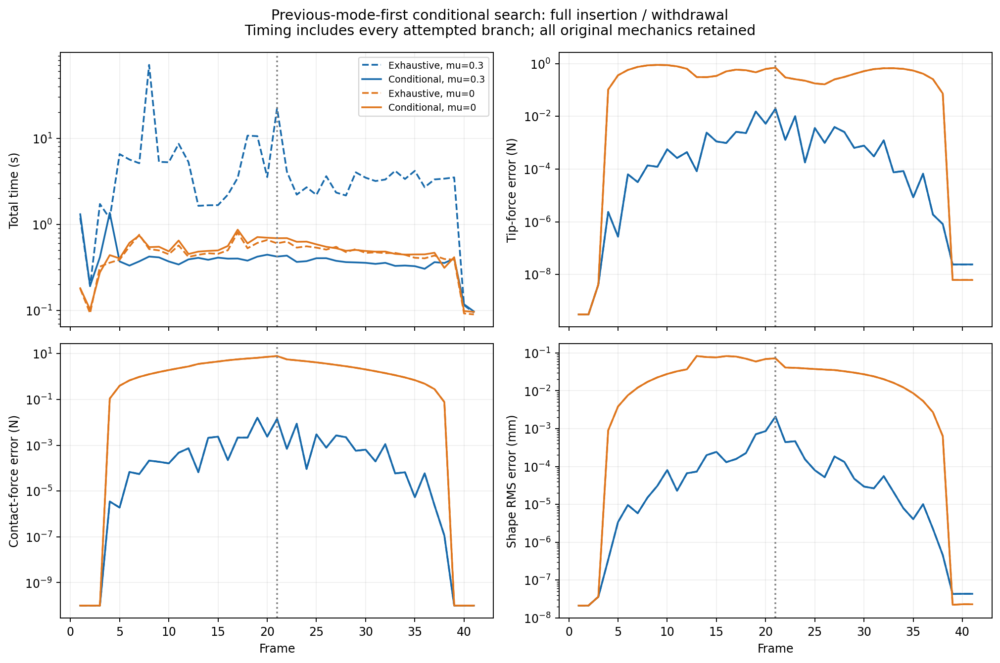

# Conditional contact-mode search: full trajectory

2026-10-10. User-approved follow-up to [exhaustive integer-mode enumeration](INCLINED_WALL_INTEGER_MODES_RESULTS.md). All changes and outputs remain in the separate collaboration package; no commit/push.

## Acceptance rule and scope

Try the preceding selected mode first, with the existing preceding-solution initialization. After a complete fmincon SQP solve, stop mode search at the first branch satisfying all of:

- Positive native solver exit.
- Implemented constraint/bound violation <= 1e-6.
- **Raw Bishop FBG RMS <= 1e-6 /mm**, explicitly selected by the user. With sensor sigma=1e-4 /mm this equals whitened RMS <= 0.01.

The 1e-6 constraint tolerance is separate from the raw FBG residual gate. The fmincon optimality and step tolerances remain 1e-8 and 1e-12. With 48 sensor residuals, the new fit threshold corresponds to unscaled objective <= 0.0024 (scaled objective <= 2.4e-7), not objective <= 1e-6. This stops the search across modes, not the inner optimizer before convergence.

If no assignment meets the rule, evaluate all assignments and return the original best feasible / least-violating fallback with `modeAccepted=false` and a reporting-only `no-acceptable-contact-mode` flag. The trajectory continues. Full nonlinear 3D Cosserat mechanics, circular friction, Stage 1, observation data, force-prior settings, diagnostics, and history policy are unchanged. Exhaustive search remains the default when the new option is omitted.

The same noiseless 41-frame inclined-wall insertion/withdrawal reference was replayed for both mu=0.3 and mu=0. True friction remains 0.3 for both. The 200 mm rod has 80 mm straight and 120 mm curved by 90 degrees; perpendicular wall distance goes 80 to 40 to 80 mm, true tip force [1,0,0] N. There are 35 true-contact frames.

## Timing and accuracy

| Metric, all 41 frames | Exhaustive mu=0.3 | Conditional mu=0.3 | Exhaustive mu=0 | Conditional mu=0 |
|---|---:|---:|---:|---:|
| Native-positive + feasible | 41/41 | 41/41 | 41/41 | 41/41 |
| Meets the new fit gate (retrospective for old results) | 41/41 | 41/41 | 8/41 | 8/41 |
| Total estimation time | 232.948 s | **16.717 s** | 18.970 s | 20.255 s |
| Mean time / step | 5.682 s | **0.408 s** | 0.463 s | 0.494 s |
| Median time / step | 3.390 s | **0.373 s** | 0.465 s | 0.491 s |
| Worst time / step | 71.007 s | **1.358 s** | 0.803 s | 0.866 s |
| Mean SQP iterations | 44.12 | **20.27** | 29.17 | 28.68 |
| Mean IVPs | 204.56 | **21.95** | 34.05 | 33.51 |
| Total IVPs | 8387 | **900** | 1396 | 1374 |
| Mode assignments evaluated | 115 | **44** | 78 | 76 |
| Tip-force RMSE | 0.004407 N | **0.004407 N** | 0.486778 N | 0.486778 N |
| Contact-force RMSE | 0.003746 N | **0.003746 N** | 3.379910 N | 3.379910 N |
| Shape RMS | 0.000392 mm | **0.000392 mm** | 0.040721 mm | 0.040721 mm |

Correct-friction runtime decreases by **13.94 times**, or 92.8%, with exactly identical saved tip and contact force components to the exhaustive run. All per-frame shape RMS values also match. Accuracy is unchanged because this trajectory's first acceptable modes are the same ones selected by exhaustive objective comparison. This is an observed property of this test, not a guarantee for arbitrary data.

All timing includes geometry, every attempted mechanics branch, and diagnostics, excluding serialization and startup. Tests were single sequential replays on the same workstation, not replicated timing trials. The mu=0 case performs nearly the same number of solves and has no meaningful speed improvement; its slightly larger measured time should not be interpreted as increased algorithmic work.



Accuracy curves coincide. Exact-zero values are floored at 1e-10 for logarithmic plotting.

## Mode transitions and failures

For mu=0.3, only two frames need another mode:

- **Frame 4, first contact:** previous separation fails the FBG gate; sticking converges but fails the FBG gate; sliding is accepted. This is the only sticking attempt in the full run. It takes 0.854 s and has no numerical/IVP failure.
- **Frame 39, detachment:** previous sliding is rejected and separation is accepted.

All other frames accept the first attempted assignment. Sliding persists through the direction reversal at frame 22; its continuous direction variable changes sign. All 35 true-contact frames and six free frames are identified correctly. There are zero failed IVPs, versus 21 in the exhaustive frictional search. The selected solves retain 40 optimality exits and one small-step exit.

Maximum raw FBG RMS is **9.254e-7 /mm**, below the requested 1e-6 /mm gate. Maximum tip/contact-force errors remain 0.019412 / 0.015913 N. The three existing dense-mesh penetration warnings at frames 19, 21, and 27 remain, maximum 1.53e-5 mm. These were not used to terminate or modify steps. No new projection/cone/dissipation warning occurs. There are 38 warning-free frames.

For mu=0, numerical convergence remains 41/41 (38 optimality exits, three small-step exits), but **frames 5-37, inclusive, fail the FBG gate for every tested mode**. These 33 frames return explicitly flagged fallback solutions; they are not successful fit acceptance. Only the six free frames and the low-force first/last contact frames 4 and 38 pass. Maximum raw FBG RMS is 6.290e-5 /mm. Mode search cannot repair the missing-friction model, so it tests both assignments at almost every loaded step. Force and shape estimates remain exactly the same as before. Existing 24 penetration and 18 tangency warnings overlap with the new 33 fit-failure flags; eight frames are warning-free.

## Threshold sensitivity and limits

Before the user's threshold reply, a preliminary run used the existing diagnostic threshold of whitened RMS 4 (raw RMS 4e-4 /mm). It is preserved separately, and is not the selected-threshold benchmark. That threshold accepted separation throughout the complete trajectory: zero of 35 actual contacts were identified. For mu=0.3 it yielded tip/contact RMSE 8.402 / 10.411 N, despite every local solve converging. This confirms why a diagnostic warning threshold was too permissive as a contact-mode acceptance criterion for this noiseless test.

The selected 1e-6 /mm gate works on this trajectory, but is only 1% of the nominal sensor standard deviation used in weighting. It should not be transferred unchanged to experiments with substantial measurement noise. A first-acceptable policy can accept a different mode with a similarly small sensor error in an ill-conditioned problem; it provides no global objective or force-accuracy certificate. Multi-contact and genuinely sticking/3D/noisy trajectories remain untested by this follow-up.

## Implementation, validation, and reproduction

`tsfs.mode_solve` now has optional conditional search and records `modeAccepted`, threshold, attempted/possible assignments, and early stopping. `tsfs.mode_branch` is byte-for-byte unchanged from the exhaustive benchmark, verified by its source hash. The common runner records the acceptance flag and a non-blocking failure diagnosis. The new wrapper defaults to the approved whitened RMS 0.01 and a separate output tag.

```matlab
setup_tsfs;
addpath('experiments/inclined_wall');
run_inclined_modes_conditional(Inf,'inclined_wall_modes_conditional_NEW_RUN',0.01);
```

The analysis script `experiments/inclined_wall/analyze_inclined_modes_conditional.py` accepts the output tag as its first argument. It verifies all 82 frames, previous-mode-first ordering, immediate stop after acceptance, exhaustive fallback when no mode passes, 48 sensor-only residuals, and exact iteration/IVP accounting. It compares all saved force components with the historical exhaustive estimates. The 120 attempted assignments (44 + 76) are all recorded.

- [All frames](../../results/published/inclined_wall_modes_conditional_1e6_20261010/estimates.csv)
- [All branch attempts](../../results/published/inclined_wall_modes_conditional_1e6_20261010/branch_attempts.csv)
- [Summary and source hashes](../../results/published/inclined_wall_modes_conditional_1e6_20261010/summary.json)
- [Configuration](../../results/published/inclined_wall_modes_conditional_1e6_20261010/configuration.json)
- Raw states/traces: `results/runs/inclined_wall_modes_conditional_1e6_20261010/comparison.mat`.
- Log: `results/runs/inclined_modes_conditional_1e6.log`.
- Preliminary broad threshold: `results/published/inclined_wall_modes_conditional_20261010/`.

Branch codex/two-stage-force-sensing, base b376013. Collaborator source and historical experiment outputs remain untouched.

## Video export (2026-10-10)

[Play the full comparison video](../../results/published/inclined_wall_modes_conditional_1e6_20261010/video/inclined_wall_comparison.mp4). The 27.33-second, 1920x1080 video shows all 41 steps at illustrative playback speed, with mu=0.3 and mu=0 side by side, true/estimated shapes, FBG fit status, solver workload, errors, and diagnostics. Failed FBG acceptance is explicitly marked as a fallback in red. Rendered only from saved estimates; simulation data unchanged. Reproduce with python experiments/inclined_wall/publish_inclined_conditional.py. Preview images and metadata are saved beside the video.

## Force-component video follow-up (2026-10-10)

The requested XYZ reference/estimated tip and contact force plots are now in results/published/inclined_wall_modes_conditional_1e6_20261010/video_forces/insertion_force_comparison.mp4. This is a new rendering of the same saved results; the earlier video remains. Frame 21 is saved as the loaded initial state for the [bidirectional rotation follow-up](INCLINED_WALL_ROTATION_RESULTS.md).
