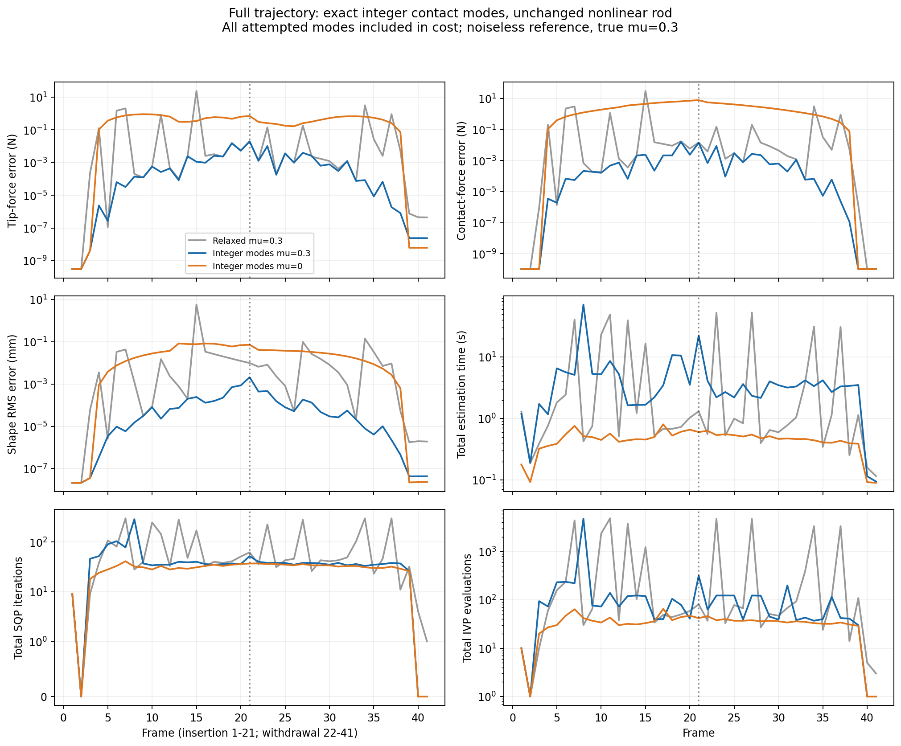
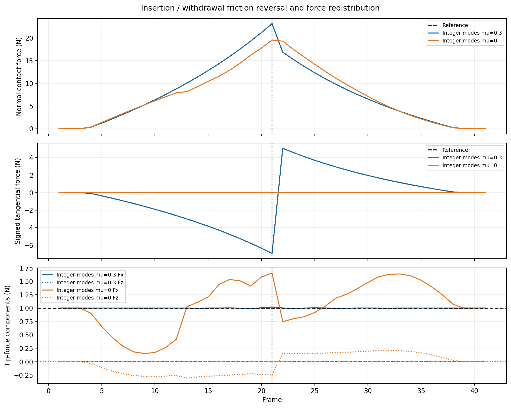

# Inclined-wall integer-mode benchmark

2026-10-10. Full 41-frame insertion/withdrawal replay, mu=0.3 and mu=0; same preserved noiseless reference and Stage-1 geometry as the previous experiment. All 82 estimates returned. No collaborator code, original outputs, default solver, or previously approved physics were changed. No commit or push.

## Main result

Explicit mode enumeration with the full nonlinear Cosserat IVP eliminated the previous large estimation outliers on this trajectory. For the correctly specified friction model, 41/41 frames were feasible with a positive native solver exit; 40/41 met fmincon's optimality termination and one stopped on small step. Mean total estimation time decreased, but exhaustive search made the median and worst-case time worse. The frictionless ablation now runs to completion, with substantial force bias despite small shape error.

This is **enumerative MINLP with local continuous SQP solves**, not a globally certified MINLP solver. The previous selected mode is tried first; every other assignment is still solved. Binary choices are handled by the enumerator, not passed to fmincon. Full mathematical and numerical details: [integer-mode formulation](../formulation/INTEGER_MODE_MECHANICS.md).

## Test and success definition

Rod: 200 mm, 80 mm straight plus 120 mm intrinsically curved by 90 degrees. Wall incline: 45 degrees. Perpendicular base-to-wall distance: 80 to 40 to 80 mm in 2 mm increments. Constant true tip force: [1,0,0] N. True friction coefficient: 0.3; both estimators observe this same reference. There is no injected sensor or environment noise. The estimator uses 24 two-component Bishop observations with standard deviation 1e-4 /mm. Stage 1 and objective/constraint scaling are unchanged; tip/contact force-prior penalties remain disabled, as in the preceding benchmark.

A successful frame means a positive fmincon exit AND all implemented branch constraints within 1e-6. This does not imply zero estimation error or warning-free continuous geometry. Strict optimality exits and dense-mesh physics warnings are reported separately. RMSE of force means the square root of the mean squared vector error norm across frames. Shape RMS pools all existing reconstruction nodes and frames.

All timing and iteration/IVP totals below include **every attempted mode**, including losing and failed branches. Per-frame time includes Stage 1, mechanics, and diagnostics, excluding saving results, rendering, and MATLAB startup. The previous relaxed data are historical measurements on the same workstation, not simultaneous replicated timing trials.

## Full trajectory results

| Metric (41 frames each) | Previous relaxed, mu=0.3 | Integer modes, mu=0.3 | Integer modes, mu=0 |
|---|---:|---:|---:|
| Successful frames | 34/41 (82.9%) | 41/41 (100%) | 41/41 (100%) |
| Optimality exit / small-step exit | 19 / 15 | 40 / 1 | 38 / 3 |
| Mode/NLP feasible frames | 40/41 | 41/41 | 41/41 |
| Total estimation time | 364.45 s | 232.95 s | 18.97 s |
| Mean time per frame | 8.889 s | 5.682 s | 0.463 s |
| Median time per frame | 0.835 s | 3.390 s | 0.465 s |
| Maximum time per frame | 52.85 s | 71.01 s | 0.803 s |
| Mean SQP iterations | 85.07 | 44.12 | 29.17 |
| Total SQP iterations | 3488 | 1809 | 1196 |
| Mean augmented IVPs | 853.07 | 204.56 | 34.05 |
| Total augmented IVPs | 34976 | 8387 | 1396 |
| Tip-force RMSE | 3.73488 N | 0.004407 N | 0.48678 N |
| Maximum tip-force error | 23.5467 N | 0.019412 N | 0.89074 N |
| Contact-force RMSE | 4.87061 N | 0.003746 N | 3.37991 N |
| Maximum contact-force error | 30.7577 N | 0.015913 N | 7.83321 N |
| Shape RMS | 0.890340 mm | 0.000392 mm | 0.040721 mm |
| Maximum per-frame shape RMS | 5.69768 mm | 0.002084 mm | 0.082905 mm |

The original relaxed mu=0 attempt crashed at the first actual contact (frame 4), after three precontact frames. There is no full-trajectory old mu=0 runtime or accuracy to compare with the new result.

For the **35 actual-contact frames only**, the previous relaxed solver succeeds on 28/35 and the new methods on 35/35. Correct-friction integer-mode tip/contact RMSE is 0.004770 / 0.004054 N; shape RMS is 0.000424 mm. Mean time is 6.461 s, with 49.37 iterations and 235.71 IVPs across all modes. The frictionless contact-only RMSE is 0.52685 / 3.65816 N, shape RMS 0.044073 mm, and mean time 0.509 s.

Log-scale error plots display exact zeros at 1e-10 for readability. Iteration plots retain zero values.

## What consumes time

The geometry stage averages 0.130 s for the frictional run and 0.109 s for mu=0. The selected frictional branch averages **0.221 s, 19.22 iterations, and 20.39 IVPs**. These winner-only quantities are explanatory; they are not the total algorithm runtime.

| Frictional assignment | Attempts | Selected | Aggregate branch time | IVPs | Outcome |
|---|---:|---:|---:|---:|---|
| Separation | 37 | 2 | 5.225 s | 510 | All feasible; poorer FBG fit during contact |
| Sticking | 37 | 0 | 213.029 s | 7049 | 5 feasible; 21 RHS-budget exceptions, 10 infeasible exits, 1 evaluation-limit exit |
| Sliding | 37 | 35 | 8.455 s | 815 | All returned feasible; selected on every true-contact frame |
| No candidate | 4 | 4 | 0.555 s | 13 | All converged |

Sticking attempts consume about 91% of total frictional estimation time. Frame 8 is the 71.01 s outlier: the selected sliding branch converges in 23 iterations, while the competing sticking branch exhausts much of its allowed evaluation budget. The 21 failed IVPs occur in losing sticking branches; all are included in IVP counts and timing. Their partial RHS evaluations cannot be counted because the callback raises an exception before returning its counter.

A failed sticking solve is **not proof that its nonlinear branch is globally infeasible**. Some sticking alternatives are feasible but have much worse sensor objectives. Separation alternatives are also feasible with changed tip loading, but the correctly specified sliding branch gives the best returned sensor fit. This is an inverse estimation problem, so geometric feasibility alone cannot select the correct load mode.

The previous mode is tried first and the existing converged previous mechanical solution supplies the continuous seed when contacts match. All assignments are checked regardless of that first result. The direction of sliding is a continuous variable, so friction reverses at frame 22 without changing the discrete label from sliding. Both runs identify all 35 active-contact frames and the six free frames correctly.

## Physics and remaining mismatch

For mu=0.3:

- Maximum implemented constraint violation: 1.65e-11 in the existing scaled/mixed-unit convention.
- Maximum contact-projection residual: 1.78e-13 N. No cone, normal-complementarity, positive-work, or active-tangency warnings. Maximum positive friction work is zero.
- Maximum terminal moment residual: 3.30e-9 N mm.
- 38/41 frames have no diagnostic warnings. Frames 19, 21, and 27 retain dense-mesh penetration warnings: 6.55e-6, 1.53e-5, and 2.74e-6 mm respectively. These are relative to the estimated Stage-1 plane. They occur between the 0.5 mm enforced samples when checked at 0.1 mm spacing. They were neither suppressed nor repaired.
- The original large spurious Y force does not recur: maximum absolute tip Fy is 2.08e-6 N.
- Largest tip error occurs at closest approach (frame 21), 0.019412 N; the return direction is also solved successfully. Maximum contact-force error is at frame 19.

Stage 1 is numerically unchanged: every estimated contact arclength matches the previous run to 1e-9 mm. The prior saved geometry audit gives maximum arc error 0.04725 mm, normal error 0.04263 degrees, and reconstructed shape RMS 0.04796 mm. Thus the improved convergence does not come from giving the new solver exact geometry or truth-derived force initialization. These residual geometric/model errors remain a plausible source of the small force bias; this run does not isolate their individual contributions.

For mu=0, all implemented constraints also solve accurately, and tangential force is zero by construction. However, 24/41 frames have diagnostic warnings (24 penetration and 18 active-contact-tangency warnings, overlapping). Maximum dense-mesh penetration is 1.77e-4 mm. Only 17/41 are warning-free. This is a deliberately incorrect friction model for the same mu=0.3 observations: its 0.0407 mm shape RMS coexists with 0.487 N tip and 3.380 N contact-force RMSE. Convergence therefore must not be confused with correct force inference. Diagnostics remain reporting-only and do not reject or modify history.

## Interpretation and limits

The observed improvement supports the earlier diagnosis of a difficult complementarity representation and branch-following problem. Fixing a mode and directly parameterizing the full sliding cone removes the relaxed product and squared-slip constraints from that continuous solve. The nonlinear rod and tip/contact coupling remain present, yet the selected branch is accurate throughout the trajectory.

This experiment changes both the contact-mode representation and its branch-specific coordinates/initialization, so the improvement cannot be attributed to binary variables alone. It is also not evidence of global nonlinear optimization. Exhaustive enumeration is practical here because there is only one candidate; it grows exponentially with contact count. The full estimator retains 3D variables, but this particular validation fixture is planar and does not establish performance on the earlier axial-rotation case, several contacts, or noisy measurements.

A subsequent speed experiment could test a previous-mode-first policy that only explores alternatives under explicitly defined residual/feasibility criteria. It would trade exhaustive search for speed; it is a proposal, not part of these measured results. No such shortcut or new rejection threshold has been introduced here.

## Validation, outputs, and reproduction

Analytic objective/constraint derivatives were checked against central differences for separation, sticking, sliding, and frictionless contact: relative discrepancies 3.84e-9, 3.51e-9, 4.86e-9, and 3.35e-8. The four-frame smoke test passed for both models. Full analysis asserts all 82 rows, 48 sensor-only objective terms, branch iteration/IVP accounting, previous-mode-first ordering, and unchanged Stage-1 arclengths.

- [Configuration](../../results/published/inclined_wall_modes_20261010/configuration.json)
- [All frame results](../../results/published/inclined_wall_modes_20261010/estimates.csv)
- [Every branch attempt, including failures](../../results/published/inclined_wall_modes_20261010/branch_attempts.csv)
- [Machine-readable summary and source hashes](../../results/published/inclined_wall_modes_20261010/summary.json)
- Raw solver traces and geometry: `results/runs/inclined_wall_modes_20261010/comparison.mat`.
- Full run log: `results/runs/inclined_modes.log`.
- [Reproduction and numerical settings](../formulation/INTEGER_MODE_MECHANICS.md).
- Runner: `experiments/inclined_wall/run_inclined_modes.m`; analysis: `experiments/inclined_wall/analyze_inclined_modes.py`.

All new files are under our package in the separate collaboration checkout, branch codex/two-stage-force-sensing, based on b376013. Historical artifacts remain intact.
