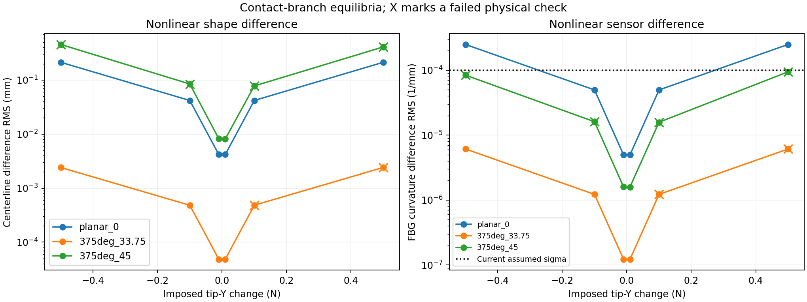
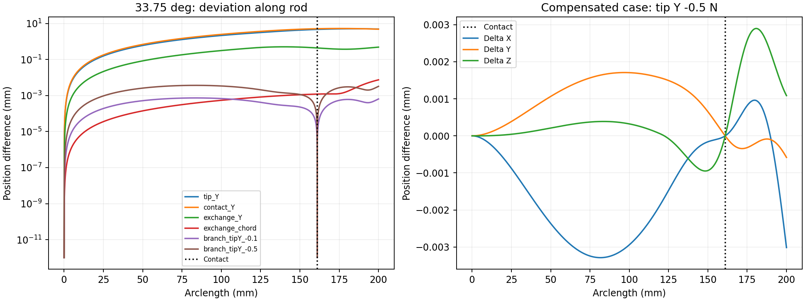
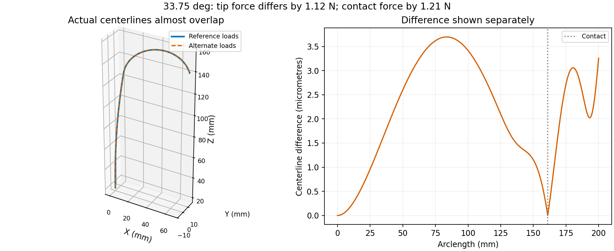

# Why tip and contact forces can produce close shapes

2026-10-07. Separate nonlinear diagnostic. No estimator settings or recorded benchmark results changed.

## Mechanical explanation

For fixed deformed positions and no distributed load, world bending moment upstream of contact is m(s) = (p_L-p(s)) cross F_tip + (p_c-p(s)) cross F_contact. Downstream it is (p_L-p(s)) cross F_tip. Thus a contact load has no direct downstream force contribution, but its upstream bending moves and rotates the downstream segment. With tip load present, that changed geometry also alters distal moments. Contact load does not affect only a local portion of the global centerline.

An equal-and-opposite transfer delta F_tip=d and delta F_contact=-d changes upstream moment by (p_L-p_c) cross d. If d is parallel to the contact-to-tip chord, this vanishes at fixed shape. In the distal segment the moment depends on distance from that chord, often a much smaller lever arm. This is a frozen-shape first-order explanation, not an exact finite nonlinear invariance. Measurements beyond contact distinguish the loads, but their responses can be small.

For contrast, a straight small-deflection planar beam gives delta curvature(s) = [delta F_tip (L-s) + delta F_contact (s_c-s) H(s_c-s)] / EI. These two spatial signatures are distinct; noiseless exact measurements can distinguish them when the sensitivity matrix has full rank. The present issue is weak separation under finite tolerance/noise and multiple adjustable force components, not identical force kernels.

## Current geometry and sensors

| State | Contact arclength mm | Remaining arc mm | Contact-tip chord mm | Distal max distance from chord mm | FBG stations beyond contact | Weak tip-direction/chord cosine |
|---|---:|---:|---:|---:|---:|---:|
| planar_0 | 160.05581 | 39.94419 | 37.06171 | 6.40224 | 5/24 | 0.99378 |
| 375deg_33.75 | 161.00564 | 38.99436 | 36.30915 | 6.11288 | 5/24 | 0.99477 |
| 375deg_45 | 161.09252 | 38.90748 | 36.23906 | 6.08755 | 5/24 | 0.99480 |

Rod length is 200 mm. FBG stations are 0, 9, 17, 26, 35, 43, 52, 61, 70, 78, 87, 96, 104, 113, 122, 130, 139, 148, 157, 165, 174, 183, 191, 200 mm. The five distal stations are 165, 174, 183, 191 and 200 mm. Spatial coverage is present; this is not an entirely uninstrumented free segment.

## Tip-only versus contact-only added loads

Each pair adds the same 0.5 N vector either at the tip or at contact, then solves terminal moment equilibrium using the nonlinear Cosserat IVP. Chord means along the baseline contact-to-tip chord. These prescribed-force comparisons do NOT impose the surface/contact law; they isolate mechanical load-location signatures. They must not be presented as two feasible sensing solutions.

| State | Added-load direction | Shape difference RMS mm | Max mm | FBG difference RMS 1/mm | RMS / current sigma |
|---|---|---:|---:|---:|---:|
| planar_0 | Y | 0.233349 | 0.464819 | 0.000236727 | 2.36727 |
| planar_0 | chord | 0.022539 | 0.037924 | 4.36795e-06 | 0.0436795 |
| 375deg_33.75 | Y | 0.354549 | 0.550413 | 0.000198004 | 1.98004 |
| 375deg_33.75 | chord | 0.0459199 | 0.0753994 | 5.3865e-06 | 0.053865 |
| 375deg_45 | Y | 0.40107 | 0.60775 | 0.000177484 | 1.77484 |
| 375deg_45 | chord | 0.0404929 | 0.0666855 | 5.08548e-06 | 0.0508548 |

## Distinct force sets satisfying the contact branch

For each state, prescribe a tip-force perturbation along the previously measured least-visible Y-compensating direction, then solve for base moment and contact force so terminal equilibrium and the original exact contact branch hold. Sticking preserves the contact point; sliding enforces zero gap and the circular sliding law against fixed previous shape. This is a constructive nonlinear feasibility test, not a globally minimized profile likelihood or a new estimator. All candidates are retained.

Physical checks require terminal moment <1e-5 N mm, gap and penetration <1e-6 mm, cone excess <1e-6 N, nonnegative normal force and contact-branch residual <1e-6 in its physical units. The current tangency warning threshold 1e-3 is also checked. Gap is checked on a 0.1 mm mesh plus continuous dense-IVP minimization within 0.5 mm on either side of contact, which catches penetration missed by the mesh. This is tolerance-based feasibility, not a proof of exact global nonpenetration/tangency.

| State | Imposed tip Y change N | Total tip change N | Total contact change N | Shape RMS mm | Shape max mm | FBG RMS 1/mm | RMS / sigma=1e-4 | Physical checks |
|---|---:|---:|---:|---:|---:|---:|---:|---|
| planar_0 | -0.5 | 0.5 | 0.486779 | 0.213353 | 0.697095 | 0.000249785 | 2.49785 | pass |
| planar_0 | -0.1 | 0.1 | 0.0936854 | 0.0418969 | 0.136315 | 4.97973e-05 | 0.497973 | pass |
| planar_0 | -0.01 | 0.01 | 0.00935304 | 0.00418674 | 0.0136192 | 4.97911e-06 | 0.0497911 | pass |
| planar_0 | 0.01 | 0.01 | 0.00935304 | 0.00418674 | 0.0136192 | 4.97911e-06 | 0.0497911 | pass |
| planar_0 | 0.1 | 0.1 | 0.0936854 | 0.0418969 | 0.136315 | 4.97973e-05 | 0.497973 | pass |
| planar_0 | 0.5 | 0.5 | 0.486779 | 0.213353 | 0.697095 | 0.000249785 | 2.49785 | pass |
| 375deg_33.75 | -0.5 | 1.12248 | 1.21126 | 0.00241083 | 0.00369716 | 6.12571e-06 | 0.0612571 | pass |
| 375deg_33.75 | -0.1 | 0.224496 | 0.242259 | 0.000482776 | 0.000740209 | 1.2246e-06 | 0.012246 | pass |
| 375deg_33.75 | -0.01 | 0.0224496 | 0.024226 | 4.82909e-05 | 7.40375e-05 | 1.22448e-07 | 0.00122448 | pass |
| 375deg_33.75 | 0.01 | 0.0224496 | 0.024226 | 4.82939e-05 | 7.40414e-05 | 1.22446e-07 | 0.00122446 | pass |
| 375deg_33.75 | 0.1 | 0.224496 | 0.242262 | 0.00048307 | 0.000740576 | 1.22434e-06 | 0.0122434 | FAIL |
| 375deg_33.75 | 0.5 | 1.12248 | 1.21134 | 0.00241816 | 0.00370635 | 6.11901e-06 | 0.0611901 | FAIL |
| 375deg_45 | -0.5 | 1.07717 | 0.743195 | 0.455747 | 0.758872 | 8.41913e-05 | 0.841913 | FAIL |
| 375deg_45 | -0.1 | 0.215434 | 0.170151 | 0.0846612 | 0.141892 | 1.61032e-05 | 0.161032 | FAIL |
| 375deg_45 | -0.01 | 0.0215434 | 0.0174441 | 0.00820161 | 0.0138243 | 1.5953e-06 | 0.015953 | pass |
| 375deg_45 | 0.01 | 0.0215434 | 0.0175275 | 0.00813338 | 0.0137328 | 1.59243e-06 | 0.0159243 | pass |
| 375deg_45 | 0.1 | 0.215434 | 0.178107 | 0.0778035 | 0.13275 | 1.58373e-05 | 0.158373 | FAIL |
| 375deg_45 | 0.5 | 1.07717 | 0.724956 | 0.410907 | 0.706946 | 9.46074e-05 | 0.946074 | FAIL |

Small residual compared with sigma does not prove two models are statistically indistinguishable: there are 48 channels and covariance/correlation matters. The CSV also reports the ratio to the older sigma=1e-6. No noise is injected. Full-rank local sensitivity and nonzero finite sensor differences mean these are close configurations, not proven exact non-uniqueness.

## Strong nonlinear example at 33.75 degrees

The baseline tip force is [1, 0, -1] N and contact force [-0.506894, -2.470703, -8.631073] N. A second equilibrium has tip force [0.318591, -0.5, -0.261320] N and contact force [0.146563, -1.957406, -9.512360] N. The tip and contact forces change by 1.12248 N and 1.21126 N respectively, but centerline RMS/max differences are only 0.00241083 / 0.00369716 mm. This is an actual nonlinear equilibrium, not a linear prediction.

Its curvature difference is 6.12571e-6 /mm RMS and 2.57778e-5 /mm maximum. The 19 upstream stations see 3.14472e-6 /mm RMS, while the five distal stations see 1.19389e-5 /mm RMS. Distal information does distinguish the forces; the signature is nonzero and concentrated there, but small.

At current independent sigma=1e-4 /mm, the full 48-channel whitened distance is sqrt(48)*0.0612571=0.424402 and the sensor negative-log-likelihood difference relative to the baseline prediction is 0.0900583 (before the extra 1e-4 numerical objective multiplier). At sigma=1e-6, distance is 42.4402 and cost about 900.583. The new covariance can therefore make this force difference hard to distinguish statistically, even though noiseless exact measurements are not identical. Changing a numerical objective multiplier does not change statistical distinguishability; changing covariance does.

Terminal moment residual is 2.05e-13 N mm, contact point/gap residual below 1.5e-13 mm, cone excess zero. Refined maximum local penetration is 4.40e-7 mm and normal-tangent dot magnitude 1.69e-4; both pass current thresholds (1e-6 mm and 1e-3). These values are not mathematically zero: the example demonstrates the current model/tolerance ambiguity, not two proven exact smooth-surface solutions. Twelve of eighteen branch-preserving candidates pass all stated checks. The opposite +0.5 N tip-Y candidate violates the friction cone by 0.877 N despite its similarly close shape, and is retained as failed.

The earlier planar sliding state is much more sensitive to Y: tip Y +/-0.5 N with contact reaction adjusted produces about 0.213 mm shape RMS difference and 2.50e-4 /mm curvature RMS difference. At rotation 45 degrees after sliding begins, large Y-profile excursions also fail penetration/tangency checks. Close shape alone is insufficient to accept a candidate.

## Same load added at tip versus contact

At 33.75 degrees, adding 0.5 N along the contact-to-tip chord at either location moves the shape by about 2.806 / 2.851 mm RMS relative to baseline. Those two resulting shapes differ by only 0.04592 mm RMS, and their sensor predictions by 5.3865e-6 /mm RMS. The same location swap for a world-Y load produces a larger 0.35455 mm / 1.9800e-4 /mm difference. These prescribed-load cases isolate the mechanics and are not asserted to satisfy the contact law.

An equal-and-opposite chord transfer (+0.5 N at tip, -0.5 N at contact) changes the baseline centerline by only 0.001588 mm RMS, versus roughly 2.8 mm if either force is changed alone. Its FBG difference is 3.37463e-6 /mm RMS. Nonlinearity means the finite tip-only/contact-only pair difference is not exactly equal to the exchange-versus-baseline difference.

The current rod is inextensible and unshearable (p'=R e3), and the sensor likelihood uses only the two Bishop bending channels. There is no axial-strain observation to help distinguish nearly axial force transfers. This is a limitation of the current modeling/measurement choice, not a statement that the physical FBG hardware cannot provide axial-strain information. Matching an integrated shape from those same channels would not create independent information.

## Reproduction and limitations

Run setup_tsfs, audit_load_transfer with TSFS_RUN_ID=base_rotation_load_transfer_20261007, then experiments/base_rotation/summarize_load_transfer.py. Diagnostic equilibrium solves use lsqnonlin with analytic IVP derivatives; only base moment and, for branch-preserving comparisons, contact force are solved. The current estimator and its optimizers are not modified. Every exit and physical residual is saved, including contact-invalid prescribed-force comparisons.

Files: geometry.json, nonlinear_candidates.csv, tip_vs_contact_pairs.csv, sensor_regions.csv and shape_profiles.csv. Fixed contact arclength/orientation and fixed preceding shape match the Stage 2 sensitivity question; uncertainty and movement in these quantities are excluded. These tests do not assess adding/removing actual contacts or changing actuation. No commit or push.
