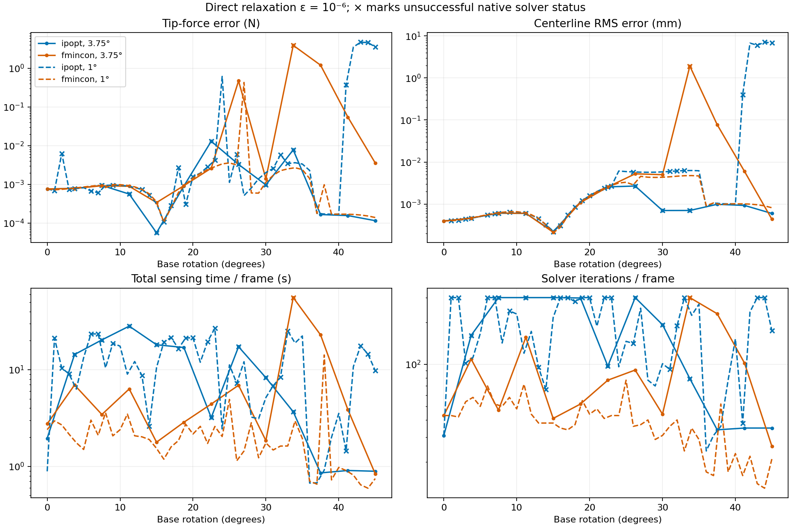
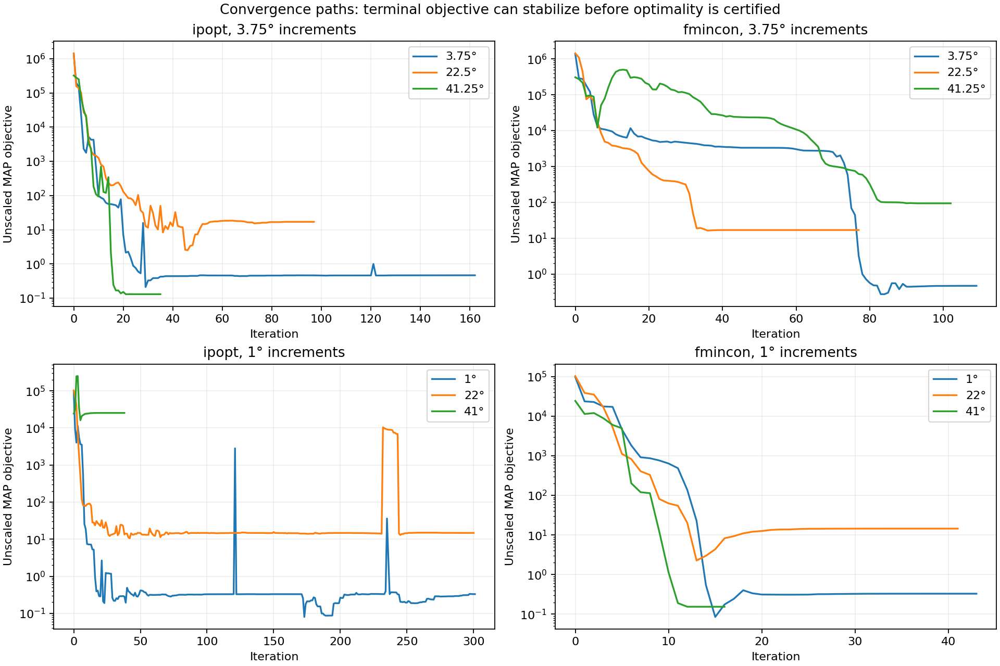

# Direct 1e-6 relaxation: rotating-rod comparison

Date: 2026-10-07. All four requested configurations were run serially, without continuation or restarts. This report includes unsuccessful solves and their consequences for later frames. The default estimator and all previous benchmark outputs remain unchanged. No commit or push.

## Scope and interpretation

Noiseless simulated Bishop measurements; true/inverse friction coefficient 0.3. The same two-stage model, priors, 3D IVP and diagnostics are used. The circular-friction model uses a smooth conic duality-gap relaxation alongside scalar Scholtes normal complementarity. This is not a polygonal friction approximation. See [the mathematical and numerical contract](../formulation/RELAXED_MECHANICS_SOLVERS.md) and [reproduction instructions](../../experiments/base_rotation/RELAXED_COMPARISON.md).

Both increments retain 0.02 s per frame and the same per-step priors. The fine-step reference is independently regenerated with its own preceding physical shape. Thus this compares 13 versus 46 updates, not equal rotation speed or identical friction trajectories. Reference solves and Bishop conversion are excluded from estimator timing. All timing is one serial workstation pass; first-frame JIT/loading is included, checkpoint I/O excluded.

## Complete-sequence results

Errors are RMS over all frames, including failures. Shape error is RMS over both centerline points and frames. Time includes geometry, mechanics and diagnostics. IVPs are full-rod augmented variational integrations; there are no nested BVP solves in these estimators.

| Increment | Solver | Frames | Native positive/success exits | Tip RMSE (N) | Contact RMSE (N) | Shape RMS (mm) | Mean s/frame | Mean iterations | Mean IVPs | Sequence s |
|---|---|---:|---:|---:|---:|---:|---:|---:|---:|---:|
| 3.75° | ipopt | 13 | 5 | 0.00434777 | 0.011176 | 0.00122203 | 10.39 | 166.3 | 742.2 | 135.09 |
| 3.75° | fmincon | 13 | 12 | 1.14793 | 2.5378 | 0.529833 | 9.279 | 101.4 | 735 | 120.63 |
| 1° | ipopt | 46 | 23 | 1.23335 | 2.31475 | 1.96651 | 11.84 | 184.5 | 863.4 | 544.44 |
| 1° | fmincon | 46 | 46 | 0.0637362 | 0.0698956 | 0.00233536 | 2.174 | 39.2 | 171.5 | 99.987 |

Native success is not equivalent to accurate estimation or verified first-order stationarity. fmincon exit 2 means small-step termination with feasibility, not meeting its first-order optimality target. IPOPT acceptable-level exits are counted separately below. Its acceptable_iter was set to zero, but the returned status still includes acceptable-level outcomes; the recorded native status takes precedence over assumptions about the setting. Reported optimality quantities use each solver's convention and are not identical independent KKT certificates.

## Stopping and physics

| Increment / solver | Native status counts | Reported optimality <= 1e-8 | Maximum tip error (N) | Maximum projection residual (N) | Maximum relaxed violation |
|---|---|---:|---:|---:|---:|
| 3.75° / ipopt | {'Solve_Succeeded': 4, 'Error_In_Step_Computation': 4, 'Maximum_Iterations_Exceeded': 4, 'Solved_To_Acceptable_Level': 1} | 4 | 0.0130262 | 0.000512317 | 7.01651e-11 |
| 3.75° / fmincon | {'fmincon-exit-2': 11, 'fmincon-exit-0': 1, 'fmincon-exit-1': 1} | 1 | 3.92992 | 0.000699617 | 4.64357e-09 |
| 1° / ipopt | {'Solve_Succeeded': 15, 'Maximum_Iterations_Exceeded': 13, 'Error_In_Step_Computation': 10, 'Solved_To_Acceptable_Level': 8} | 13 | 4.74264 | 1.91277 | 5.22462 |
| 1° / fmincon | {'fmincon-exit-2': 46} | 0 | 0.432166 | 0.000698351 | 1.67451e-10 |

| Increment / solver | Max terminal moment (N mm) | Max estimated-plane penetration (mm) | Max true-plane penetration (mm) | Max positive friction work (N mm) | Max cone excess (N) | Max normal product (N mm) |
|---|---:|---:|---:|---:|---:|---:|
| 3.75° / ipopt | 6.3834e-09 | 1.8561e-07 | 0.00082304 | 9.9813e-07 | 0 | 9.9989e-07 |
| 3.75° / fmincon | 4.7219e-09 | 0.00066833 | 0.00081125 | 4.8076e-08 | 4.1314e-06 | 1e-06 |
| 1° / ipopt | 25.63 | 5.8269e-05 | 0.00080575 | 9.9953e-07 | 2.2857 | 3.4609e-06 |
| 1° / fmincon | 3.349e-08 | 0 | 0.00080574 | 1e-06 | 1.6751e-12 | 1e-06 |

A fixed 1e-6 N mm friction duality gap is not a 1e-6 N force-projection guarantee. On the sliding boundary, squared friction-direction error is bounded by 2 R epsilon / ||slip||. Smaller per-step slip can therefore loosen the force-direction allowance for the same epsilon. Near sticking, the squared slip cone also has small derivatives; finite constraint tolerance can translate into a larger slip error. The mathematical contract derives these effects.

## Stage 1

| Increment / solver | Maximum arclength error (mm) | Maximum normal error (degrees) |
|---|---:|---:|
| 3.75° / ipopt | 0.00149843 | 0.00232957 |
| 3.75° / fmincon | 0.00149843 | 0.00232957 |
| 1° / ipopt | 0.00166164 | 0.00286614 |
| 1° / fmincon | 0.00166164 | 0.00286614 |

Stage 1 is independent of the mechanics solver, and the duplicate geometry columns permit checking that both solvers received the same geometry. Small Stage 1 errors do not guarantee good nonlinear solver convergence. These runs do not separately identify geometry bias, nonconvex branches and stopping behavior as causal sources of every outlier.

## Convergence paths and interpretation

- Coarse IPOPT has 0.00435 N tip-force RMSE and avoids the previous custom-SQP 22.5-degree error of about 0.71 N. Its own 22.5-degree error is 0.0130 N and its native status is unsuccessful. At 41.25 degrees its error is 0.000156 N with success. This is strong estimation accuracy, not uniform convergence.
- Coarse fmincon develops 0.474 N tip error at 26.25 degrees, reaches 300 iterations at 33.75 degrees with 3.93 N error, and has 1.21 N error at 37.5 degrees before recovering. Its 33.75-degree MAP objective is about 5.60e7. The preceding finite state continues to feed history and priors under the existing policy.
- At 1 degree, fmincon improves to 0.0637 N tip RMSE and 2.17 s/frame, but has a 0.432 N outlier at 27 degrees. All 46 exits are small-step exits, none satisfy its first-order criterion. IPOPT has a 0.619 N outlier at 24 degrees and a failure chain starting at 41 degrees; errors reach 4.74 N and the final frame is still inaccurate. Its 1-degree tip RMSE is 1.233 N and mean time is 11.84 s/frame.
- Smaller increments help fmincon in this particular run, but do not establish a robust direct-relaxation method. The two solvers received identical Stage 1 geometry at each increment; solver/globalization behavior and recurrent history differ. These data cannot by themselves establish global nonuniqueness or assign every bad result to one cause.
- IPOPT often spends a substantial tail trying to certify stationarity after the objective and feasibility have stabilized. For the coarse 3.75-degree frame, the saved trace first reaches feasibility and within 1% (or 0.001 absolute) of its terminal cost at trace index 71, but the reported total is 161 iterations with a failed step computation. Trace indices can include restoration entries.
- These results do not establish that a four-level continuation schedule is required. They establish that this direct-1e-6 formulation and these settings are not uniformly robust. The next controlled tests should examine constraint/optimality scaling and the sticking cone, then compare a short 1e-4 -> 1e-6 schedule against this preserved reference. No additional continuation has been run or substituted here.
- The historical custom semismooth SQP averaged approximately 0.272 s/frame, 7.62 iterations and 16.62 total IVPs on the 13-frame Bishop test, with tip RMSE 0.197 N. Its reported 13/13 convergence includes the previously audited premature 22.5-degree stop; its loose convergence test and mixed state/variational IVPs make an equivalent-accuracy speed comparison inappropriate.

## Settings and validation

Both solvers: epsilon=1e-6; fixed objective multiplier 1e-4; 300 iterations; optimality target 1e-8; constraint tolerance 1e-9. fmincon SQP uses analytic first derivatives and step tolerance 1e-12. IPOPT 3.14.19 via CasADi 3.8.0 uses limited-memory Hessian, no additional NLP scaling and no bound relaxation. ODE relative tolerance 2e-8, scaled absolute tolerance 2e-10. The same initial state/prior policy is retained; multipliers and Hessians are not transferred between frames.

Constraint derivative central-difference checks passed at 0, 22.5 and 41.25 degrees (relative discrepancies 3.87e-7, 8.61e-8 and 3.57e-8). The zero-force/nonzero-slip cone test passed. Every fine-step mechanical reference frame passed its independent physical audit. Full settings, objective blocks, solver traces and frame CSVs are published in the two run directories. The dependency archive is stored only in ignored package-local storage, including its license notices.

## Every frame

Flags and all force components, residual blocks, geometry errors, diagnostic timing and ODE RHS counts are in the linked CSV files. Tables below retain every native failure rather than filtering the averages.

### 3.75 degrees, ipopt

[Complete frame data](../../results/published/base_rotation_relaxed_375deg_20261007/ipopt_frames.csv) · [Iteration trace](../../results/published/base_rotation_relaxed_375deg_20261007/ipopt_iterations.csv) · [Objective blocks](../../results/published/base_rotation_relaxed_375deg_20261007/ipopt_objective_blocks.csv)

| Angle | Native status | s/frame | Iterations | IVPs | Tip error N | Contact error N | Shape RMS mm | Projection N |
|---:|---|---:|---:|---:|---:|---:|---:|---:|
| 0 | Solve_Succeeded | 1.95257 | 31 | 46 | 0.000764251 | 0.00270162 | 0.000397138 | 5.49979e-07 |
| 3.75 | Error_In_Step_Computation | 14.3653 | 161 | 1071 | 0.000785308 | 0.00335046 | 0.000464711 | 5.51404e-07 |
| 7.5 | Maximum_Iterations_Exceeded | 20.3454 | 300 | 1513 | 0.000940316 | 0.00469804 | 0.000609773 | 8.38819e-06 |
| 11.25 | Maximum_Iterations_Exceeded | 28.2412 | 300 | 2138 | 0.000562423 | 0.00456058 | 0.000601688 | 3.66173e-06 |
| 15 | Maximum_Iterations_Exceeded | 18.125 | 300 | 1313 | 5.60735e-05 | 0.000500725 | 0.000221758 | 2.1864e-06 |
| 18.75 | Solved_To_Acceptable_Level | 16.9723 | 298 | 1211 | 0.00090823 | 0.00853978 | 0.00109692 | 1.57354e-06 |
| 22.5 | Error_In_Step_Computation | 3.19764 | 97 | 207 | 0.0130262 | 0.0297656 | 0.00257016 | 1.04288e-06 |
| 26.25 | Maximum_Iterations_Exceeded | 17.2952 | 300 | 1211 | 0.00328077 | 0.0199831 | 0.00269196 | 1.20422e-05 |
| 30 | Error_In_Step_Computation | 8.26751 | 192 | 554 | 0.000970004 | 0.00499954 | 0.000703936 | 5.22963e-06 |
| 33.75 | Error_In_Step_Computation | 3.6734 | 79 | 248 | 0.00781406 | 0.0133463 | 0.000706235 | 1.785e-06 |
| 37.5 | Solve_Succeeded | 0.85618 | 34 | 44 | 0.000166112 | 0.000573023 | 0.000990174 | 0.000512317 |
| 41.25 | Solve_Succeeded | 0.906656 | 35 | 47 | 0.000156278 | 0.000542629 | 0.000930763 | 4.66102e-05 |
| 45 | Solve_Succeeded | 0.890574 | 35 | 45 | 0.000115304 | 0.000346239 | 0.000600275 | 0.000226442 |

Diagnostic flag counts: `{"mechanics-Error_In_Step_Computation": 4, "mechanics-Maximum_Iterations_Exceeded": 4, "contact-projection": 11, "positive-friction-work": 3}`

### 3.75 degrees, fmincon

[Complete frame data](../../results/published/base_rotation_relaxed_375deg_20261007/fmincon_frames.csv) · [Iteration trace](../../results/published/base_rotation_relaxed_375deg_20261007/fmincon_iterations.csv) · [Objective blocks](../../results/published/base_rotation_relaxed_375deg_20261007/fmincon_objective_blocks.csv)

| Angle | Native status | s/frame | Iterations | IVPs | Tip error N | Contact error N | Shape RMS mm | Projection N |
|---:|---|---:|---:|---:|---:|---:|---:|---:|
| 0 | fmincon-exit-2 | 2.7532 | 43 | 197 | 0.000763309 | 0.00270184 | 0.000397136 | 5.79529e-07 |
| 3.75 | fmincon-exit-2 | 6.94835 | 109 | 485 | 0.000782481 | 0.00335203 | 0.000464676 | 7.30921e-07 |
| 7.5 | fmincon-exit-2 | 3.44195 | 47 | 247 | 0.000923549 | 0.00462307 | 0.000612171 | 6.45955e-07 |
| 11.25 | fmincon-exit-2 | 6.32582 | 156 | 496 | 0.000894011 | 0.0045201 | 0.000603097 | 5.62041e-07 |
| 15 | fmincon-exit-2 | 1.77956 | 41 | 127 | 0.000339509 | 0.000410947 | 0.000214966 | 5.82164e-07 |
| 18.75 | fmincon-exit-2 | 2.8614 | 52 | 216 | 0.000925189 | 0.00847948 | 0.00109068 | 7.36591e-07 |
| 22.5 | fmincon-exit-2 | 4.41442 | 77 | 335 | 0.0026198 | 0.0200196 | 0.0025589 | 1.02963e-06 |
| 26.25 | fmincon-exit-2 | 6.90832 | 91 | 538 | 0.47385 | 0.515083 | 0.00524908 | 8.20811e-05 |
| 30 | fmincon-exit-2 | 1.84785 | 44 | 132 | 0.00140281 | 0.00442513 | 0.00501261 | 3.93855e-07 |
| 33.75 | fmincon-exit-0 | 55.7318 | 300 | 4584 | 3.92992 | 8.99013 | 1.90874 | 6.264e-05 |
| 37.5 | fmincon-exit-1 | 22.923 | 230 | 1847 | 1.20778 | 1.62057 | 0.0775129 | 0.000582398 |
| 41.25 | fmincon-exit-2 | 3.8563 | 102 | 295 | 0.0546913 | 0.103611 | 0.00598955 | 0.000699617 |
| 45 | fmincon-exit-2 | 0.83779 | 26 | 56 | 0.00358108 | 0.00705852 | 0.000438031 | 0.000698606 |

Diagnostic flag counts: `{"contact-projection": 6, "positive-friction-work": 1, "mechanics-fmincon-exit-0": 1, "penetration": 1, "active-contact-tangency": 1, "friction-cone": 1, "fbg-mismatch": 2}`

### 1 degrees, ipopt

[Complete frame data](../../results/published/base_rotation_relaxed_1deg_20261007/ipopt_frames.csv) · [Iteration trace](../../results/published/base_rotation_relaxed_1deg_20261007/ipopt_iterations.csv) · [Objective blocks](../../results/published/base_rotation_relaxed_1deg_20261007/ipopt_objective_blocks.csv)

| Angle | Native status | s/frame | Iterations | IVPs | Tip error N | Contact error N | Shape RMS mm | Projection N |
|---:|---|---:|---:|---:|---:|---:|---:|---:|
| 0 | Solve_Succeeded | 0.889045 | 31 | 46 | 0.000764251 | 0.00270162 | 0.000397138 | 5.49979e-07 |
| 1 | Maximum_Iterations_Exceeded | 21.1777 | 300 | 1591 | 0.000686674 | 0.0023854 | 0.000406312 | 4.2601e-06 |
| 2 | Maximum_Iterations_Exceeded | 10.4166 | 300 | 736 | 0.00631188 | 0.00608227 | 0.000409906 | 5.49292e-05 |
| 3 | Error_In_Step_Computation | 9.02723 | 102 | 681 | 0.000743568 | 0.00303479 | 0.000439532 | 5.50796e-07 |
| 4 | Solved_To_Acceptable_Level | 6.30176 | 112 | 452 | 0.000780585 | 0.00335108 | 0.000471065 | 5.51494e-07 |
| 5 | Solve_Succeeded | 13.3322 | 166 | 996 | 0.000823064 | 0.0037125 | 0.00050932 | 5.52356e-07 |
| 6 | Maximum_Iterations_Exceeded | 23.4532 | 300 | 1756 | 0.00068037 | 0.00415348 | 0.000551002 | 1.4322e-06 |
| 7 | Maximum_Iterations_Exceeded | 23.4698 | 300 | 1753 | 0.000605269 | 0.00457395 | 0.000591916 | 5.36148e-07 |
| 8 | Solved_To_Acceptable_Level | 10.4511 | 142 | 766 | 0.0009404 | 0.00474821 | 0.000626562 | 5.56017e-07 |
| 9 | Error_In_Step_Computation | 18.81 | 241 | 1402 | 0.000957493 | 0.00492203 | 0.00064727 | 5.45608e-07 |
| 10 | Solved_To_Acceptable_Level | 17.5204 | 229 | 1291 | 0.000949675 | 0.00490017 | 0.000645438 | 5.59274e-07 |
| 11 | Solved_To_Acceptable_Level | 8.99895 | 120 | 667 | 0.000909115 | 0.00462257 | 0.000613962 | 5.61131e-07 |
| 12 | Solved_To_Acceptable_Level | 12.1585 | 172 | 898 | 0.000829929 | 0.00404717 | 0.000548654 | 5.63123e-07 |
| 13 | Error_In_Step_Computation | 8.70631 | 95 | 649 | 0.000734902 | 0.00311935 | 0.000448698 | 1.50831e-06 |
| 14 | Error_In_Step_Computation | 2.61345 | 66 | 176 | 0.000528731 | 0.00187952 | 0.000323292 | 1.17583e-06 |
| 15 | Solved_To_Acceptable_Level | 10.5354 | 216 | 750 | 0.00031934 | 0.000311564 | 0.000228657 | 5.54598e-07 |
| 16 | Maximum_Iterations_Exceeded | 19.3375 | 300 | 1408 | 0.00010743 | 0.00167341 | 0.000309466 | 8.09339e-06 |
| 17 | Maximum_Iterations_Exceeded | 21.5469 | 300 | 1573 | 0.00028804 | 0.00399403 | 0.000551979 | 7.01141e-07 |
| 18 | Error_In_Step_Computation | 16.5391 | 281 | 1199 | 0.0027418 | 0.00743225 | 0.000852669 | 7.08169e-07 |
| 19 | Maximum_Iterations_Exceeded | 21.3075 | 300 | 1566 | 0.000306148 | 0.0103985 | 0.0012136 | 4.03323e-06 |
| 20 | Maximum_Iterations_Exceeded | 21.3862 | 300 | 1567 | 0.00159648 | 0.0123911 | 0.00159893 | 9.89475e-07 |
| 21 | Solve_Succeeded | 11.9532 | 187 | 871 | 0.00195205 | 0.0156139 | 0.00199693 | 8.94583e-07 |
| 22 | Maximum_Iterations_Exceeded | 19.537 | 300 | 1430 | 0.0028366 | 0.0184195 | 0.00240226 | 3.32437e-06 |
| 23 | Maximum_Iterations_Exceeded | 26.8525 | 300 | 2001 | 0.00421529 | 0.0203184 | 0.00268042 | 0.000246703 |
| 24 | Solve_Succeeded | 2.43914 | 96 | 147 | 0.61858 | 0.674068 | 0.00612532 | 8.77465e-05 |
| 25 | Solve_Succeeded | 11.2235 | 146 | 822 | 0.00112752 | 0.0140882 | 0.00593685 | 9.15585e-07 |
| 26 | Error_In_Step_Computation | 7.23306 | 141 | 503 | 0.00593635 | 0.0125852 | 0.00581867 | 1.26608e-06 |
| 27 | Solve_Succeeded | 12.1 | 252 | 841 | 0.000514401 | 0.00672209 | 0.00574656 | 1.73021e-06 |
| 28 | Solve_Succeeded | 3.23237 | 77 | 201 | 0.000807497 | 0.00318055 | 0.00571712 | 1.15697e-06 |
| 29 | Solve_Succeeded | 3.11222 | 70 | 205 | 0.00139756 | 0.00295476 | 0.0057443 | 1.32859e-06 |
| 30 | Solve_Succeeded | 5.15502 | 101 | 354 | 0.00202227 | 0.00694056 | 0.00583444 | 1.33243e-06 |
| 31 | Error_In_Step_Computation | 6.8255 | 92 | 482 | 0.00258683 | 0.0108652 | 0.00597036 | 4.79026e-07 |
| 32 | Error_In_Step_Computation | 8.35806 | 189 | 573 | 0.00581655 | 0.015245 | 0.00614345 | 7.33376e-07 |
| 33 | Maximum_Iterations_Exceeded | 25.1382 | 300 | 1800 | 0.00345246 | 0.0167859 | 0.00626046 | 7.70319e-07 |
| 34 | Solved_To_Acceptable_Level | 18.9053 | 224 | 1357 | 0.00363571 | 0.0171882 | 0.00629293 | 6.09347e-07 |
| 35 | Solved_To_Acceptable_Level | 22.3483 | 269 | 1632 | 0.00335704 | 0.0154303 | 0.00620939 | 5.76021e-07 |
| 36 | Solve_Succeeded | 0.672522 | 24 | 34 | 0.00229577 | 0.00521318 | 0.000861029 | 0.000698321 |
| 37 | Solve_Succeeded | 0.67592 | 31 | 34 | 0.000177664 | 0.000623606 | 0.00106545 | 0.000261803 |
| 38 | Solve_Succeeded | 0.915034 | 36 | 52 | 0.000171696 | 0.000601805 | 0.00102601 | 4.69087e-05 |
| 39 | Solve_Succeeded | 1.99612 | 77 | 126 | 0.00016965 | 0.000594511 | 0.00101277 | 2.09344e-05 |
| 40 | Solve_Succeeded | 3.53284 | 152 | 221 | 0.000170052 | 0.00059617 | 0.00101501 | 5.06952e-06 |
| 41 | Error_In_Step_Computation | 1.45536 | 38 | 93 | 0.374356 | 0.496761 | 0.403534 | 5.69807e-06 |
| 42 | Solve_Succeeded | 10.7723 | 237 | 817 | 3.55674 | 7.86649 | 6.72939 | 5.62692e-05 |
| 43 | Maximum_Iterations_Exceeded | 17.7161 | 300 | 1355 | 4.74264 | 7.72512 | 5.99543 | 1.91277 |
| 44 | Maximum_Iterations_Exceeded | 14.517 | 300 | 1084 | 4.63274 | 7.84077 | 7.0709 | 0.18942 |
| 45 | Error_In_Step_Computation | 9.79587 | 174 | 760 | 3.58391 | 7.92025 | 6.81904 | 3.58501e-07 |

Diagnostic flag counts: `{"mechanics-Maximum_Iterations_Exceeded": 13, "contact-projection": 24, "mechanics-Error_In_Step_Computation": 10, "positive-friction-work": 6, "penetration": 1, "active-contact-tangency": 1, "fbg-mismatch": 5, "terminal-equilibrium": 2, "friction-cone": 2}`

### 1 degrees, fmincon

[Complete frame data](../../results/published/base_rotation_relaxed_1deg_20261007/fmincon_frames.csv) · [Iteration trace](../../results/published/base_rotation_relaxed_1deg_20261007/fmincon_iterations.csv) · [Objective blocks](../../results/published/base_rotation_relaxed_1deg_20261007/fmincon_objective_blocks.csv)

| Angle | Native status | s/frame | Iterations | IVPs | Tip error N | Contact error N | Shape RMS mm | Projection N |
|---:|---|---:|---:|---:|---:|---:|---:|---:|
| 0 | fmincon-exit-2 | 2.40064 | 43 | 197 | 0.000763309 | 0.00270184 | 0.000397136 | 5.79529e-07 |
| 1 | fmincon-exit-2 | 2.95819 | 43 | 221 | 0.000724136 | 0.00279964 | 0.000402488 | 6.50217e-07 |
| 2 | fmincon-exit-2 | 2.6849 | 42 | 215 | 0.00074542 | 0.0029703 | 0.000418115 | 5.54698e-07 |
| 3 | fmincon-exit-2 | 2.15169 | 54 | 170 | 0.000775998 | 0.00322043 | 0.000443564 | 5.5077e-07 |
| 4 | fmincon-exit-2 | 1.75484 | 58 | 143 | 0.000813881 | 0.00353536 | 0.00047763 | 5.5208e-07 |
| 5 | fmincon-exit-2 | 1.49617 | 50 | 117 | 0.000856247 | 0.00389649 | 0.000518131 | 5.52494e-07 |
| 6 | fmincon-exit-2 | 3.01004 | 70 | 246 | 0.000900623 | 0.00427526 | 0.000561834 | 5.53631e-07 |
| 7 | fmincon-exit-2 | 2.0957 | 52 | 169 | 0.000941583 | 0.0046379 | 0.00060437 | 2.8858e-07 |
| 8 | fmincon-exit-2 | 3.59458 | 50 | 298 | 0.00082559 | 0.00498411 | 0.000639888 | 5.62e-07 |
| 9 | fmincon-exit-2 | 2.07067 | 58 | 168 | 0.000990188 | 0.00510781 | 0.000661123 | 5.59045e-07 |
| 10 | fmincon-exit-2 | 2.39719 | 48 | 189 | 0.000982764 | 0.00508477 | 0.00065931 | 6.34457e-07 |
| 11 | fmincon-exit-2 | 3.47392 | 72 | 294 | 0.00094092 | 0.00480691 | 0.000627265 | 5.74204e-07 |
| 12 | fmincon-exit-2 | 2.07212 | 44 | 159 | 0.000862711 | 0.00423042 | 0.000560513 | 5.64582e-07 |
| 13 | fmincon-exit-2 | 2.02156 | 38 | 164 | 0.000740728 | 0.00332374 | 0.000457352 | 6.03501e-07 |
| 14 | fmincon-exit-2 | 1.89583 | 38 | 152 | 0.000570101 | 0.00206754 | 0.000324021 | 6.51095e-07 |
| 15 | fmincon-exit-2 | 1.53544 | 38 | 120 | 0.00035287 | 0.000479769 | 0.000208136 | 5.78058e-07 |
| 16 | fmincon-exit-2 | 1.18638 | 35 | 91 | 0.000104553 | 0.00154572 | 0.000280997 | 6.63707e-07 |
| 17 | fmincon-exit-2 | 1.59249 | 34 | 125 | 0.000253651 | 0.00384193 | 0.000526104 | 7.57309e-07 |
| 18 | fmincon-exit-2 | 1.84682 | 37 | 142 | 0.000612625 | 0.00644012 | 0.000839391 | 7.09635e-07 |
| 19 | fmincon-exit-2 | 2.72842 | 55 | 222 | 0.00101516 | 0.00928683 | 0.00119337 | 7.29654e-07 |
| 20 | fmincon-exit-2 | 2.16199 | 44 | 168 | 0.00145731 | 0.012311 | 0.0015753 | 7.98489e-07 |
| 21 | fmincon-exit-2 | 2.59602 | 48 | 213 | 0.00192311 | 0.0154439 | 0.00197442 | 8.45039e-07 |
| 22 | fmincon-exit-2 | 1.72724 | 41 | 130 | 0.00240515 | 0.0186031 | 0.00238015 | 9.5377e-07 |
| 23 | fmincon-exit-2 | 2.58895 | 43 | 211 | 0.00287331 | 0.021718 | 0.00278195 | 1.13693e-06 |
| 24 | fmincon-exit-2 | 2.03803 | 43 | 160 | 0.00337906 | 0.0246834 | 0.00317021 | 1.10236e-06 |
| 25 | fmincon-exit-2 | 4.92624 | 77 | 408 | 0.00360142 | 0.0257261 | 0.00331429 | 1.49432e-06 |
| 26 | fmincon-exit-2 | 1.1418 | 36 | 81 | 0.00317407 | 0.0221381 | 0.00286705 | 1.71357e-06 |
| 27 | fmincon-exit-2 | 1.44367 | 37 | 108 | 0.432166 | 0.469768 | 0.00457757 | 7.65336e-05 |
| 28 | fmincon-exit-2 | 2.82714 | 40 | 223 | 0.000599345 | 0.00660074 | 0.00436229 | 9.32083e-07 |
| 29 | fmincon-exit-2 | 1.22794 | 29 | 92 | 0.000594861 | 0.00234897 | 0.00431518 | 1.98682e-07 |
| 30 | fmincon-exit-2 | 1.74577 | 31 | 136 | 0.00114227 | 0.00300759 | 0.00435364 | 4.70683e-07 |
| 31 | fmincon-exit-2 | 1.47779 | 36 | 108 | 0.00171272 | 0.00684849 | 0.00446001 | 4.88018e-07 |
| 32 | fmincon-exit-2 | 1.62263 | 40 | 121 | 0.00226562 | 0.010434 | 0.00461011 | 5.57029e-07 |
| 33 | fmincon-exit-2 | 1.62628 | 24 | 125 | 0.00252109 | 0.0127495 | 0.00473301 | 3.35175e-06 |
| 34 | fmincon-exit-2 | 2.95332 | 35 | 231 | 0.00269621 | 0.0131333 | 0.00476448 | 5.84681e-07 |
| 35 | fmincon-exit-2 | 1.94578 | 29 | 151 | 0.00241657 | 0.0113782 | 0.00467961 | 4.30797e-07 |
| 36 | fmincon-exit-2 | 0.704106 | 17 | 45 | 0.00142053 | 0.00337145 | 0.000915934 | 0.000698351 |
| 37 | fmincon-exit-2 | 0.654541 | 16 | 45 | 0.000177574 | 0.000623569 | 0.00106546 | 0.000164273 |
| 38 | fmincon-exit-2 | 14.204 | 52 | 1162 | 0.000981481 | 0.00218097 | 0.000972153 | 0.000402369 |
| 39 | fmincon-exit-2 | 0.724797 | 17 | 47 | 0.0001695 | 0.000594225 | 0.0010127 | 3.03702e-05 |
| 40 | fmincon-exit-2 | 0.976193 | 23 | 71 | 0.000169796 | 0.000595747 | 0.00101502 | 4.75334e-06 |
| 41 | fmincon-exit-2 | 0.906427 | 16 | 63 | 0.00016987 | 0.000596314 | 0.00101459 | 8.86045e-06 |
| 42 | fmincon-exit-2 | 0.812765 | 22 | 57 | 0.00016724 | 0.00058761 | 0.00100001 | 2.50462e-05 |
| 43 | fmincon-exit-2 | 0.643884 | 14 | 40 | 0.000161479 | 0.000567103 | 0.000965753 | 4.7196e-05 |
| 44 | fmincon-exit-2 | 0.594778 | 13 | 39 | 0.000152482 | 0.000533387 | 0.000909471 | 7.17447e-05 |
| 45 | fmincon-exit-2 | 0.747658 | 21 | 51 | 0.000139206 | 0.000479636 | 0.0008198 | 0.000107999 |

Diagnostic flag counts: `{"positive-friction-work": 5, "contact-projection": 16}`
