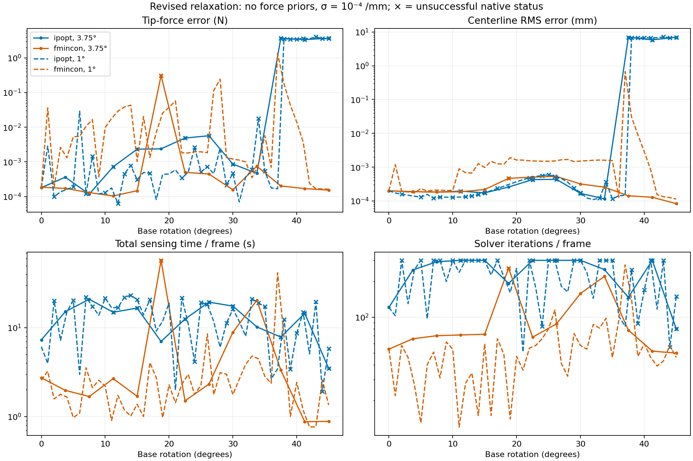
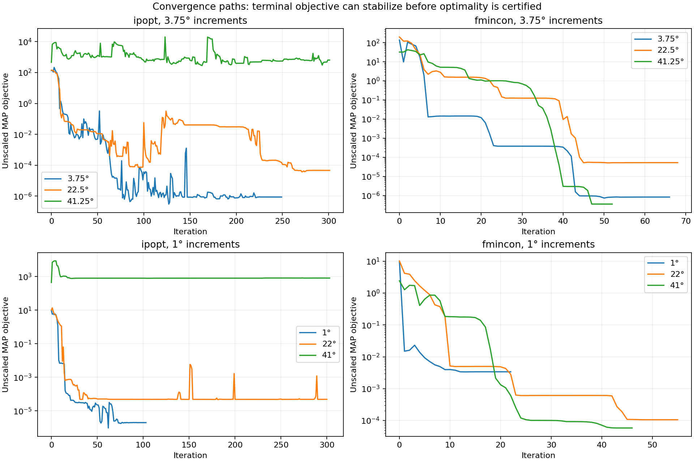

# Revised rotating-rod solver comparison

2026-10-07. All four requested configurations were run serially, with all failures retained. Previous results are preserved. No commit or push.

## Requested configuration

Force-prior penalties are disabled completely. Both stages use FBG standard deviation 1e-4 /mm (covariance 1e-8 I); samples remain noiseless and unchanged. Nonlinear constraint tolerance is 1e-6. Duplicate contact-gap rows are removed. Epsilon stays 1e-6, objective multiplier stays 1e-4, optimality target stays 1e-8, and the maximum iteration count stays 300. All variable and constraint Jacobian-row scaling stays unchanged. Previous-state numerical initialization and preceding-shape friction history remain.

[Exact implementation/reproduction contract](../../experiments/base_rotation/RELAXED_COMPARISON_V2.md). Geometry still precedes mechanics once per frame; diagnostics do not reject or correct steps. Both increment sizes retain the original 0.02 s sample interval and their independently generated friction reference trajectory.

## Complete results

All errors below include every frame. Shape RMS aggregates points and frames. Timing includes geometry, mechanics setup/solve and diagnostics but excludes saving/export. Each IVP is an augmented full-rod variational integration.

| Solver | Step | Frames | Native success/positive | Relaxed feasible | Tip RMSE N | Contact RMSE N | Shape RMS mm | Mean s/frame | Mean iterations | Mean IVPs |
|---|---:|---:|---:|---:|---:|---:|---:|---:|---:|---:|
| ipopt | 3.75° | 13 | 5 | 12 | 1.71362 | 3.91507 | 3.17218 | 12.89 | 240.9 | 914.9 |
| fmincon | 3.75° | 13 | 12 | 13 | 0.0852468 | 0.0908313 | 0.000298522 | 8.183 | 100.4 | 658 |
| ipopt | 1° | 46 | 20 | 44 | 1.5034 | 3.28955 | 2.83185 | 13.1 | 218.6 | 923.2 |
| fmincon | 1° | 46 | 46 | 46 | 0.203341 | 0.174248 | 0.0992743 | 3.268 | 57.13 | 254.8 |

Native success, sampled relaxed feasibility and exact contact-law consistency are different criteria. fmincon exit 2 is a small-step stop, not its first-order success criterion. IPOPT acceptable-level exits are retained distinctly. No failure is removed from the means.

## Comparison with the previous experiment

| Solver / step | Tip RMSE old -> new (N) | Contact RMSE old -> new (N) | Mean time old -> new (s) | Iterations old -> new | IVPs old -> new |
|---|---:|---:|---:|---:|---:|
| ipopt / 3.75° | 0.0043478 -> 1.7136 | 0.011176 -> 3.9151 | 10.39 -> 12.89 | 166.3 -> 240.9 | 742.2 -> 914.9 |
| fmincon / 3.75° | 1.1479 -> 0.085247 | 2.5378 -> 0.090831 | 9.279 -> 8.183 | 101.4 -> 100.4 | 735 -> 658 |
| ipopt / 1° | 1.2333 -> 1.5034 | 2.3148 -> 3.2895 | 11.84 -> 13.1 | 184.5 -> 218.6 | 863.4 -> 923.2 |
| fmincon / 1° | 0.063736 -> 0.20334 | 0.069896 -> 0.17425 | 2.174 -> 3.268 | 39.2 -> 57.13 | 171.5 -> 254.8 |

This is a combined four-change experiment. It cannot attribute improvement or deterioration uniquely to covariance, prior removal, tolerance or deduplication. With only FBG residuals, sigma changes Stage 2 objective scaling at fixed geometry/history; Stage 1 geometry changes too because its sensor/environment balance changes.

## Statuses and physical diagnostics

| Solver / step | Native status counts | Max tip error N | Max relaxed violation | Max original projection N |
|---|---|---:|---:|---:|
| ipopt / 3.75° | {'Solve_Succeeded': 1, 'Solved_To_Acceptable_Level': 4, 'Maximum_Iterations_Exceeded': 6, 'Error_In_Step_Computation': 2} | 3.6676 | 0.21328 | 0.37134 |
| fmincon / 3.75° | {'fmincon-exit-2': 8, 'fmincon-exit-0': 1, 'fmincon-exit-1': 4} | 0.30736 | 1.1927e-09 | 8.4201e-05 |
| ipopt / 1° | {'Solve_Succeeded': 3, 'Solved_To_Acceptable_Level': 17, 'Maximum_Iterations_Exceeded': 20, 'Error_In_Step_Computation': 6} | 4.0121 | 6.2042e-05 | 0.007299 |
| fmincon / 1° | {'fmincon-exit-2': 34, 'fmincon-exit-1': 12} | 1.3357 | 5.1609e-07 | 0.00070304 |

Updated `flags` use gap tolerance 1e-6 mm, moment tolerance 2e-4 N mm, squared-cone tolerance 1e-6 and product/duality-gap upper bound 2e-6 N mm. `exactLawFlags` separately retains the previous tighter physical warnings; all original residual magnitudes remain in the CSVs. The projection is not a constraint in this smooth relaxed NLP. A dense-grid penetration flag can occur even when sampled relaxed feasibility passes.

| Solver / step | Max moment N mm | Max penetration mm | Max positive work N mm | Max cone excess N | Max arclength error mm | Max normal error deg |
|---|---:|---:|---:|---:|---:|---:|
| ipopt / 3.75° | 0.054335 | 3.6406e-08 | 0 | 0.46182 | 0.0022719 | 0.00032356 |
| fmincon / 3.75° | 2.3854e-07 | 1.0287e-07 | 9.112e-07 | 0 | 0.0022719 | 0.00032356 |
| ipopt / 1° | 0.0099391 | 0 | 4.4596e-07 | 0.0078764 | 0.0026593 | 0.00039464 |
| fmincon / 1° | 5.1276e-06 | 8.8543e-08 | 1.0001e-06 | 4.4409e-16 | 0.0026593 | 0.00039464 |

## Jacobian-row audit

The fixed-state test verifies that changing FBG covariance leaves the entire mechanical constraint Jacobian unchanged. The whitened sensor Jacobian divides by 100, and the sensor objective/gradient by 10,000. Deleting duplicate rows leaves all retained constraint values/gradients exactly unchanged. Central-difference derivative checks passed at 0 and 22.5 degrees (relative errors about 3.87e-7 and 8.63e-8). New objectives have exactly 48 sensor terms; exported tip/contact prior costs are zero.

At the actual terminal states, constraint rows can change because the solutions change. The following compares median terminal row norms and the largest slip-cone multiplier; these are in the unchanged optimization coordinates.

| Solver / step | Normal-product row median old -> new | Squared-slip row median old -> new | Max squared-slip multiplier old -> new | Median initial objective gradient old -> new |
|---|---:|---:|---:|---:|
| ipopt / 3.75° | 37.666 -> 33.269 | 7.7163e-05 -> 0.00021562 | 4.0505e+05 -> 58.912 | 3400.7 -> 0.34903 |
| fmincon / 3.75° | 35.848 -> 37.543 | 2.1105e-05 -> 3.1e-05 | 4.0003e+05 -> 7.3213 | 3435.5 -> 0.34179 |
| ipopt / 1° | 35.631 -> 34.231 | 2.7186e-05 -> 0.00010638 | 1.0779e+09 -> 105.39 | 956.68 -> 0.16153 |
| fmincon / 1° | 37.628 -> 37.54 | 1.9401e-05 -> 0.00020152 | 4.9623e+05 -> 13.533 | 915.19 -> 0.091528 |

The old residual Jacobian included force-prior rows; the new one does not. Observation-Jacobian conditioning and derivative norms are not independent KKT certificates. A scalar likelihood scale does not directly repair vanishing squared-cone derivatives. The exact relationship between row balance and every convergence failure requires a controlled fixed-problem test, beyond this combined comparison.

## Main findings and remaining failures

Coarse fmincon improved, but the changes are not a uniform improvement: fine fmincon and both IPOPT sequences have larger aggregate errors than before. A smaller rotation increment does not guarantee robustness. All averages include the first frame and unsuccessful outputs.

- fmincon, 3.75 degrees: the main force outlier is 18.75 degrees (0.30736 N tip error, 57.425 s, 258 iterations, 4744 augmented IVPs). It exhausted the 5000 function-evaluation budget, not the 300-iteration budget. The next frame recovers to 0.000500 N tip error. Every sampled relaxed problem is feasible.
- fmincon, 1 degree: 27 and 28 degrees have 0.114 and 0.242 N tip errors. The largest error is at 37 degrees: 1.33567 N tip, 1.06640 N contact, 0.67250 mm shape RMS, 41.551 s, 275 iterations and 3338 IVPs. This is exit 2 (small step), with stationarity 4.45e-4 rather than the requested 1e-8. Error declines after that frame and reaches 0.000163 N at 45 degrees. Only 12/46 frames meet the reported first-order target, despite 46 positive exits.
- IPOPT: severe failure begins at 37.5 degrees for the coarse sequence and 38 degrees for the fine sequence. The coarse failure increases sensor cost from 36.277 to 862.706 while reducing sampled constraint violation to 1.86e-13. The fine failure increases sensor cost from 2.630 to 801.725 with violation 7.78e-16. These are failed solves, not evidence that the poor fits are competing optimal MAP solutions. The fine 42-degree output is even reported acceptable while retaining 3.555 N tip error and an FBG mismatch warning.

At those first IPOPT failures, normal force collapses from the warm-start values 8.630 N / 7.728 N to 5.03e-8 N / 6.58e-8 N. The auxiliary slip bound beta grows to 421.17 mm / 69.23 mm while actual slip is only 13.83 mm / 11.50 mm. At zero contact force, beta has no objective penalty and the friction duality expression loses its beta dependence; this is a concrete numerical weakness of the conic epigraph representation. It permits a physically admissible detached state, but does not make the poor sensor fit optimal. No new beta penalty, bound, cone treatment, or restart has been introduced.

Stage 1 is identical between solvers at each increment size and remains very accurate: maximum arclength errors are 0.002272 / 0.002659 mm and maximum normal errors are 0.000324 / 0.000395 degrees (coarse / fine). Gross geometry bias therefore does not explain the late failures; sensitivity to small geometry differences is not ruled out.

Removing force penalties does not remove recurrence: both the numerical seed and friction displacement use the preceding mechanical estimate. An inaccurate accepted frame can alter the next problem. At fine fmincon 38 degrees, native first-order convergence with 0.179 N error occurs after the bad 37-degree history. Separating that history effect from local optimization requires a controlled replay and has not been done.

The larger assumed sigma also weakens the mismatch warning in physical curvature units. At fine fmincon 37 degrees, curvature RMS error is 7.60e-5 /mm, only 0.760 sigma. Consequently its revised flags are empty despite the large force/shape errors; the historical contact-projection warning remains visible. Passing diagnostics is not a truth-accuracy certificate. No noise was injected in these runs.

## Every frame

### ipopt, 3.75 degrees

[Full frame data](../../results/published/base_rotation_relaxed_v2_375deg_20261007/ipopt_frames.csv) · [Iteration traces](../../results/published/base_rotation_relaxed_v2_375deg_20261007/ipopt_iterations.csv) · [Objective blocks](../../results/published/base_rotation_relaxed_v2_375deg_20261007/ipopt_objective_blocks.csv)

| Angle | Status | Seconds | Iterations | IVPs | Tip error N | Contact error N | Shape RMS mm | Relaxed feasible |
|---:|---|---:|---:|---:|---:|---:|---:|---:|
| 0 | Solve_Succeeded | 7.305 | 121 | 431 | 0.00018042 | 0.00050595 | 0.00019927 | 1 |
| 3.75 | Solved_To_Acceptable_Level | 15.18 | 249 | 1075 | 0.00036194 | 0.00042171 | 0.00018858 | 1 |
| 7.5 | Solved_To_Acceptable_Level | 20.94 | 292 | 1565 | 0.00011733 | 0.00012922 | 0.00018311 | 1 |
| 11.25 | Maximum_Iterations_Exceeded | 14.95 | 300 | 1088 | 0.00072225 | 0.00084164 | 0.00019492 | 1 |
| 15 | Maximum_Iterations_Exceeded | 16.65 | 300 | 1200 | 0.0023225 | 0.0028461 | 0.00017389 | 1 |
| 18.75 | Solved_To_Acceptable_Level | 7.011 | 192 | 467 | 0.0023736 | 0.0024269 | 0.00025814 | 1 |
| 22.5 | Maximum_Iterations_Exceeded | 12.54 | 300 | 884 | 0.0048688 | 0.0073098 | 0.00042947 | 1 |
| 26.25 | Maximum_Iterations_Exceeded | 19.42 | 300 | 1402 | 0.0056665 | 0.0077521 | 0.00043429 | 1 |
| 30 | Maximum_Iterations_Exceeded | 17.54 | 300 | 1238 | 0.00086279 | 0.00098142 | 0.0001677 | 1 |
| 33.75 | Solved_To_Acceptable_Level | 10.23 | 251 | 671 | 0.00046794 | 0.00061919 | 0.00011519 | 1 |
| 37.5 | Error_In_Step_Computation | 7.863 | 147 | 569 | 3.6608 | 8.3338 | 6.954 | 1 |
| 41.25 | Maximum_Iterations_Exceeded | 14.51 | 300 | 1051 | 3.3648 | 8.012 | 5.8576 | 0 |
| 45 | Error_In_Step_Computation | 3.496 | 80 | 253 | 3.6676 | 8.1005 | 6.9387 | 1 |

Updated flag counts: `{"mechanics-Maximum_Iterations_Exceeded": 6, "mechanics-Error_In_Step_Computation": 2, "fbg-mismatch": 3, "terminal-equilibrium": 1, "relaxed-force-cone": 1, "relaxed-nlp-infeasible": 1}`

Historical exact-law warning counts: `{"contact-projection": 6, "terminal-equilibrium": 1, "friction-cone": 1}`

### fmincon, 3.75 degrees

[Full frame data](../../results/published/base_rotation_relaxed_v2_375deg_20261007/fmincon_frames.csv) · [Iteration traces](../../results/published/base_rotation_relaxed_v2_375deg_20261007/fmincon_iterations.csv) · [Objective blocks](../../results/published/base_rotation_relaxed_v2_375deg_20261007/fmincon_objective_blocks.csv)

| Angle | Status | Seconds | Iterations | IVPs | Tip error N | Contact error N | Shape RMS mm | Relaxed feasible |
|---:|---|---:|---:|---:|---:|---:|---:|---:|
| 0 | fmincon-exit-2 | 2.733 | 54 | 198 | 0.00018581 | 0.00050645 | 0.00019882 | 1 |
| 3.75 | fmincon-exit-2 | 1.974 | 66 | 153 | 0.00017174 | 0.0003777 | 0.00018865 | 1 |
| 7.5 | fmincon-exit-2 | 1.682 | 70 | 129 | 0.00013006 | 0.00015873 | 0.00018231 | 1 |
| 11.25 | fmincon-exit-2 | 2.677 | 71 | 208 | 0.00010382 | 0.00016426 | 0.00018713 | 1 |
| 15 | fmincon-exit-2 | 1.694 | 72 | 123 | 0.00014735 | 0.00078983 | 0.00021823 | 1 |
| 18.75 | fmincon-exit-0 | 57.43 | 258 | 4744 | 0.30736 | 0.32745 | 0.00046537 | 1 |
| 22.5 | fmincon-exit-1 | 1.506 | 68 | 108 | 0.0005004 | 0.0037129 | 0.00050827 | 1 |
| 26.25 | fmincon-exit-1 | 2.321 | 88 | 178 | 0.00044601 | 0.0036766 | 0.00053112 | 1 |
| 30 | fmincon-exit-2 | 8.894 | 158 | 709 | 0.00015691 | 0.0012466 | 0.00031835 | 1 |
| 33.75 | fmincon-exit-2 | 20.37 | 220 | 1627 | 0.00075019 | 0.00067075 | 0.00025582 | 1 |
| 37.5 | fmincon-exit-2 | 3.346 | 78 | 258 | 0.00020195 | 0.00017442 | 0.00014217 | 1 |
| 41.25 | fmincon-exit-1 | 0.8757 | 52 | 59 | 0.00016983 | 0.00011161 | 0.00012869 | 1 |
| 45 | fmincon-exit-1 | 0.8837 | 50 | 60 | 0.00015334 | 9.5371e-05 | 8.3288e-05 | 1 |

Updated flag counts: `{"mechanics-fmincon-exit-0": 1}`

Historical exact-law warning counts: `{"contact-projection": 7, "positive-friction-work": 1}`

### ipopt, 1 degrees

[Full frame data](../../results/published/base_rotation_relaxed_v2_1deg_20261007/ipopt_frames.csv) · [Iteration traces](../../results/published/base_rotation_relaxed_v2_1deg_20261007/ipopt_iterations.csv) · [Objective blocks](../../results/published/base_rotation_relaxed_v2_1deg_20261007/ipopt_objective_blocks.csv)

| Angle | Status | Seconds | Iterations | IVPs | Tip error N | Contact error N | Shape RMS mm | Relaxed feasible |
|---:|---|---:|---:|---:|---:|---:|---:|---:|
| 0 | Solve_Succeeded | 6.112 | 121 | 431 | 0.00018042 | 0.00050595 | 0.00019927 | 1 |
| 1 | Solved_To_Acceptable_Level | 3.968 | 103 | 271 | 0.0028636 | 0.0037122 | 0.00017208 | 1 |
| 2 | Maximum_Iterations_Exceeded | 20.12 | 300 | 1485 | 9.8496e-05 | 0.00027415 | 0.00015822 | 1 |
| 3 | Solved_To_Acceptable_Level | 7.203 | 130 | 516 | 0.00013698 | 0.00019139 | 0.00014794 | 1 |
| 4 | Solved_To_Acceptable_Level | 15.1 | 251 | 1106 | 0.00016131 | 0.00020563 | 0.00013777 | 1 |
| 5 | Maximum_Iterations_Exceeded | 20.35 | 300 | 1502 | 0.0001893 | 0.00014259 | 0.00013002 | 1 |
| 6 | Solved_To_Acceptable_Level | 2.983 | 97 | 192 | 0.029016 | 0.03172 | 0.0001563 | 1 |
| 7 | Maximum_Iterations_Exceeded | 22.12 | 300 | 1641 | 0.00012029 | 0.00017486 | 0.00012184 | 1 |
| 8 | Maximum_Iterations_Exceeded | 17.4 | 300 | 1281 | 0.0014619 | 0.0014493 | 0.00013085 | 1 |
| 9 | Solved_To_Acceptable_Level | 13.81 | 199 | 1020 | 0.00011837 | 0.00029278 | 0.00012889 | 1 |
| 10 | Maximum_Iterations_Exceeded | 21.55 | 300 | 1605 | 0.00013051 | 2.4303e-05 | 0.00012895 | 1 |
| 11 | Solved_To_Acceptable_Level | 16.8 | 238 | 1249 | 0.00017711 | 0.00015463 | 0.00013006 | 1 |
| 12 | Maximum_Iterations_Exceeded | 16.92 | 300 | 1225 | 6.2493e-05 | 6.9325e-05 | 0.00013311 | 1 |
| 13 | Maximum_Iterations_Exceeded | 21.98 | 300 | 1565 | 0.00044728 | 0.00053257 | 0.00014175 | 1 |
| 14 | Maximum_Iterations_Exceeded | 23.28 | 300 | 1489 | 0.0007856 | 0.00088155 | 0.00015356 | 1 |
| 15 | Maximum_Iterations_Exceeded | 20.75 | 300 | 1462 | 0.00030608 | 0.00076365 | 0.00017327 | 1 |
| 16 | Solved_To_Acceptable_Level | 13.98 | 226 | 994 | 0.000496 | 0.0012801 | 0.00020127 | 1 |
| 17 | Maximum_Iterations_Exceeded | 20.79 | 300 | 1489 | 0.00046789 | 0.0015497 | 0.00023394 | 1 |
| 18 | Solved_To_Acceptable_Level | 9.187 | 219 | 638 | 8.1916e-05 | 0.0015459 | 0.00027299 | 1 |
| 19 | Solved_To_Acceptable_Level | 11.86 | 161 | 858 | 0.00043645 | 0.0022976 | 0.0003192 | 1 |
| 20 | Solved_To_Acceptable_Level | 18.97 | 257 | 1373 | 0.00044703 | 0.0027283 | 0.00037139 | 1 |
| 21 | Solved_To_Acceptable_Level | 1.993 | 51 | 129 | 0.00058621 | 0.0032647 | 0.00042594 | 1 |
| 22 | Maximum_Iterations_Exceeded | 21.79 | 300 | 1574 | 0.00034163 | 0.0034365 | 0.00048094 | 1 |
| 23 | Solved_To_Acceptable_Level | 11.09 | 176 | 788 | 0.00050073 | 0.0040143 | 0.00053291 | 1 |
| 24 | Error_In_Step_Computation | 4.159 | 84 | 281 | 0.0026438 | 0.0070943 | 0.00055982 | 1 |
| 25 | Maximum_Iterations_Exceeded | 19.24 | 300 | 1384 | 0.0005123 | 0.0044514 | 0.00059824 | 1 |
| 26 | Maximum_Iterations_Exceeded | 18.39 | 300 | 1299 | 0.00073047 | 0.0045483 | 0.00052851 | 1 |
| 27 | Solved_To_Acceptable_Level | 11.77 | 182 | 787 | 0.00045641 | 0.0033277 | 0.00046195 | 1 |
| 28 | Solved_To_Acceptable_Level | 6.035 | 163 | 400 | 0.0024885 | 0.0031912 | 0.00035791 | 1 |
| 29 | Maximum_Iterations_Exceeded | 11.29 | 300 | 751 | 0.00021562 | 0.001685 | 0.00024449 | 1 |
| 30 | Maximum_Iterations_Exceeded | 16.21 | 300 | 1124 | 0.00046766 | 0.00057346 | 0.00017393 | 1 |
| 31 | Solved_To_Acceptable_Level | 11.8 | 238 | 809 | 6.988e-05 | 0.00024652 | 0.00012242 | 1 |
| 32 | Solved_To_Acceptable_Level | 8.028 | 144 | 544 | 0.00036404 | 0.00047395 | 0.00011021 | 1 |
| 33 | Maximum_Iterations_Exceeded | 21.12 | 300 | 1493 | 0.00059354 | 0.00090907 | 0.00012156 | 1 |
| 34 | Maximum_Iterations_Exceeded | 19.02 | 300 | 1337 | 0.01769 | 0.027477 | 0.00037016 | 1 |
| 35 | Maximum_Iterations_Exceeded | 17.33 | 300 | 1199 | 0.00054855 | 0.00070295 | 0.00011514 | 1 |
| 36 | Solve_Succeeded | 2.64 | 102 | 161 | 0.00017708 | 0.000117 | 0.0001423 | 1 |
| 37 | Solve_Succeeded | 3.457 | 84 | 222 | 0.00016722 | 0.00011542 | 0.00014724 | 1 |
| 38 | Error_In_Step_Computation | 12.41 | 250 | 500 | 3.5568 | 7.9372 | 6.713 | 1 |
| 39 | Error_In_Step_Computation | 3.431 | 89 | 237 | 3.4599 | 7.8821 | 6.7086 | 1 |
| 40 | Error_In_Step_Computation | 8.678 | 169 | 632 | 3.4439 | 7.8613 | 6.7031 | 1 |
| 41 | Maximum_Iterations_Exceeded | 14.97 | 300 | 1082 | 3.6273 | 7.8587 | 6.7124 | 0 |
| 42 | Solved_To_Acceptable_Level | 5.072 | 117 | 358 | 3.5555 | 7.8666 | 6.7294 | 1 |
| 43 | Maximum_Iterations_Exceeded | 19.63 | 300 | 1463 | 4.0121 | 7.8786 | 7.1358 | 0 |
| 44 | Error_In_Step_Computation | 1.918 | 56 | 127 | 3.5717 | 7.8992 | 6.7864 | 1 |
| 45 | Error_In_Step_Computation | 5.837 | 149 | 394 | 3.5824 | 7.9202 | 6.8245 | 1 |

Updated flag counts: `{"mechanics-Maximum_Iterations_Exceeded": 20, "mechanics-Error_In_Step_Computation": 6, "fbg-mismatch": 8, "terminal-equilibrium": 2, "relaxed-nlp-infeasible": 2, "relaxed-force-cone": 1}`

Historical exact-law warning counts: `{"contact-projection": 36, "positive-friction-work": 1, "terminal-equilibrium": 2, "friction-cone": 2}`

### fmincon, 1 degrees

[Full frame data](../../results/published/base_rotation_relaxed_v2_1deg_20261007/fmincon_frames.csv) · [Iteration traces](../../results/published/base_rotation_relaxed_v2_1deg_20261007/fmincon_iterations.csv) · [Objective blocks](../../results/published/base_rotation_relaxed_v2_1deg_20261007/fmincon_objective_blocks.csv)

| Angle | Status | Seconds | Iterations | IVPs | Tip error N | Contact error N | Shape RMS mm | Relaxed feasible |
|---:|---|---:|---:|---:|---:|---:|---:|---:|
| 0 | fmincon-exit-2 | 2.571 | 54 | 198 | 0.00018581 | 0.00050645 | 0.00019882 | 1 |
| 1 | fmincon-exit-2 | 3.234 | 22 | 258 | 0.036144 | 0.083021 | 0.0011826 | 1 |
| 2 | fmincon-exit-2 | 1.581 | 58 | 122 | 0.00018326 | 0.00045492 | 0.00019258 | 1 |
| 3 | fmincon-exit-2 | 1.78 | 46 | 135 | 0.0026154 | 0.0024025 | 0.00018424 | 1 |
| 4 | fmincon-exit-2 | 1.665 | 27 | 126 | 0.0013121 | 0.0015041 | 0.00017201 | 1 |
| 5 | fmincon-exit-2 | 0.9742 | 13 | 70 | 0.0053293 | 0.012882 | 0.00023301 | 1 |
| 6 | fmincon-exit-2 | 1.093 | 40 | 78 | 0.0054118 | 0.0068016 | 0.00019585 | 1 |
| 7 | fmincon-exit-2 | 3.552 | 51 | 283 | 0.01059 | 0.012532 | 0.00020801 | 1 |
| 8 | fmincon-exit-2 | 2.115 | 31 | 167 | 0.016531 | 0.019174 | 0.00020917 | 1 |
| 9 | fmincon-exit-2 | 2.569 | 62 | 202 | 0.0003709 | 0.0013269 | 0.00020388 | 1 |
| 10 | fmincon-exit-2 | 2.206 | 54 | 175 | 0.0098018 | 0.01167 | 0.00020645 | 1 |
| 11 | fmincon-exit-2 | 0.9028 | 12 | 65 | 0.017862 | 0.046172 | 0.00089688 | 1 |
| 12 | fmincon-exit-2 | 1.731 | 28 | 135 | 0.029004 | 0.033721 | 0.00068492 | 1 |
| 13 | fmincon-exit-2 | 1.188 | 34 | 86 | 0.038321 | 0.044011 | 0.000668 | 1 |
| 14 | fmincon-exit-2 | 1.013 | 15 | 74 | 0.043294 | 0.081503 | 0.0012727 | 1 |
| 15 | fmincon-exit-2 | 1.378 | 60 | 104 | 0.0010324 | 0.0040286 | 0.00097928 | 1 |
| 16 | fmincon-exit-2 | 1.001 | 15 | 73 | 0.020344 | 0.054516 | 0.0014798 | 1 |
| 17 | fmincon-exit-2 | 4.054 | 66 | 318 | 0.0013394 | 0.0047343 | 0.0012572 | 1 |
| 18 | fmincon-exit-2 | 2.743 | 49 | 214 | 0.00707 | 0.010921 | 0.0012285 | 1 |
| 19 | fmincon-exit-2 | 0.9728 | 14 | 71 | 0.025784 | 0.071437 | 0.0019118 | 1 |
| 20 | fmincon-exit-2 | 2.281 | 47 | 178 | 0.037433 | 0.044334 | 0.0016283 | 1 |
| 21 | fmincon-exit-2 | 1.433 | 36 | 105 | 0.057166 | 0.065697 | 0.0016144 | 1 |
| 22 | fmincon-exit-2 | 2.311 | 55 | 183 | 0.001823 | 0.0042918 | 0.0015383 | 1 |
| 23 | fmincon-exit-2 | 2.995 | 58 | 236 | 0.0018063 | 0.0038675 | 0.0015148 | 1 |
| 24 | fmincon-exit-1 | 1.777 | 66 | 137 | 0.001948 | 0.0035329 | 0.0014998 | 1 |
| 25 | fmincon-exit-1 | 2.27 | 80 | 176 | 0.0019473 | 0.0034245 | 0.0014995 | 1 |
| 26 | fmincon-exit-1 | 8.522 | 115 | 689 | 0.0018371 | 0.0038398 | 0.001525 | 1 |
| 27 | fmincon-exit-2 | 1.767 | 41 | 134 | 0.11425 | 0.12628 | 0.0016495 | 1 |
| 28 | fmincon-exit-2 | 3.124 | 32 | 243 | 0.24199 | 0.26625 | 0.0016869 | 1 |
| 29 | fmincon-exit-1 | 2.999 | 73 | 231 | 0.0013333 | 0.0048214 | 0.0014606 | 1 |
| 30 | fmincon-exit-1 | 1.767 | 58 | 132 | 0.0012075 | 0.0054558 | 0.0015093 | 1 |
| 31 | fmincon-exit-2 | 2.637 | 54 | 198 | 0.0011251 | 0.0060253 | 0.0015558 | 1 |
| 32 | fmincon-exit-2 | 3.877 | 87 | 303 | 0.00099612 | 0.0065384 | 0.0015975 | 1 |
| 33 | fmincon-exit-2 | 4.808 | 81 | 382 | 0.000349 | 0.0071448 | 0.0016224 | 1 |
| 34 | fmincon-exit-2 | 4.479 | 98 | 353 | 0.00083903 | 0.0067793 | 0.0016008 | 1 |
| 35 | fmincon-exit-2 | 2.841 | 46 | 219 | 0.005693 | 0.010792 | 0.0015662 | 1 |
| 36 | fmincon-exit-1 | 2.371 | 94 | 182 | 0.00069787 | 0.0015117 | 0.00012757 | 1 |
| 37 | fmincon-exit-2 | 41.55 | 275 | 3338 | 1.3357 | 1.0664 | 0.6725 | 1 |
| 38 | fmincon-exit-1 | 8.081 | 142 | 632 | 0.17908 | 0.36035 | 0.030667 | 1 |
| 39 | fmincon-exit-1 | 1.006 | 47 | 71 | 0.043279 | 0.086175 | 0.0090204 | 1 |
| 40 | fmincon-exit-1 | 2.431 | 60 | 184 | 0.01392 | 0.027271 | 0.0028456 | 1 |
| 41 | fmincon-exit-1 | 1.184 | 46 | 85 | 0.0037905 | 0.0072997 | 0.00083572 | 1 |
| 42 | fmincon-exit-1 | 0.7626 | 39 | 48 | 0.0002403 | 0.00025767 | 0.00015398 | 1 |
| 43 | fmincon-exit-1 | 0.7685 | 43 | 50 | 0.00016785 | 0.00011547 | 0.00013334 | 1 |
| 44 | fmincon-exit-2 | 2.593 | 58 | 183 | 0.00016628 | 0.00011295 | 0.00012595 | 1 |
| 45 | fmincon-exit-2 | 1.353 | 46 | 96 | 0.00016253 | 0.00010805 | 0.00011348 | 1 |

Updated flag counts: `{}`

Historical exact-law warning counts: `{"contact-projection": 28, "positive-friction-work": 10}`
