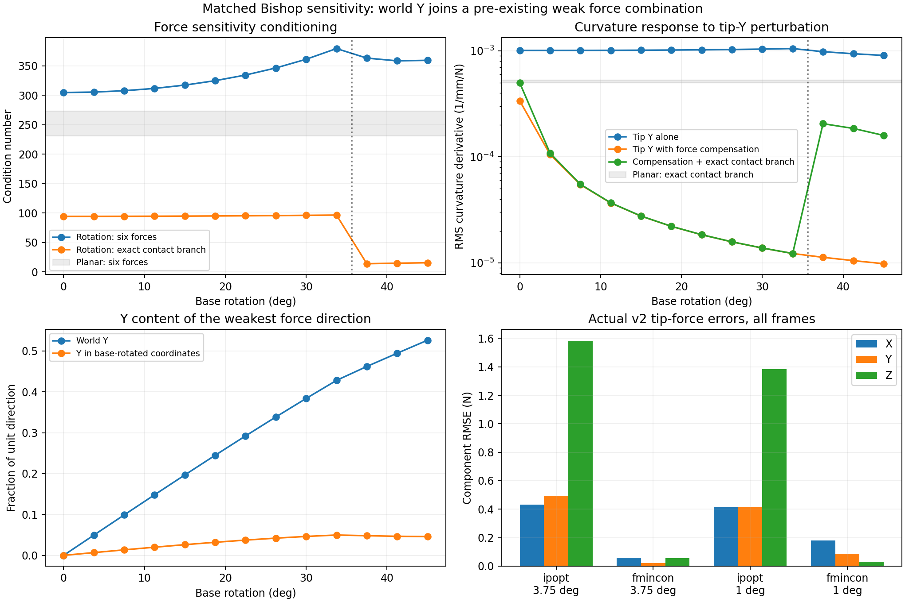

# Rotation versus planar sliding: directional force sensitivity

2026-10-07. Offline diagnostic; estimator settings and previous outputs unchanged. No commit or push.

## Main result

Rotation makes world-Y force separation much weaker once the other force components can compensate, but it does not create a new exact force singularity. The weak force direction that already lies in XZ in the planar case mostly rotates into world Y. Additional difficulty comes from following a sticking-to-sliding transition and from the relaxed cone formulation/globalization; the local correct-branch inverse problem actually becomes better conditioned at sliding onset.

## Comparable analysis

71 physically validated reference states: 12 prior sliding frames, 13 coarse rotation frames and 46 fine rotation frames. Both cases use the current two-channel Bishop observation derivative, the same full 3D Cosserat mechanics, and physical world-force coordinates [tip XYZ; contact XYZ] in N. Reference contact geometry is fixed solely for this offline local audit; no truth is supplied to an estimator. The earlier planar estimator was already 3D and allowed Y forces. Its physical state remained planar by symmetry.

Using terminal moment e(m,F)=0 to eliminate the three base-moment perturbations gives the 48 by 6 measurement sensitivity G = w_F - w_m (e_m inverse) e_F, with contact forces transformed to world coordinates. No force priors, whitening, objective multiplier, or optimizer Hessian enter these physical derivative values. All six singular values are nonzero. Initial/final convergence is not inferred from a sensitivity condition number.

Tip-Y-only sensitivity is RMS(G e_Y). Profiled sensitivity solves min ||G d|| subject to d_tipY=1, allowing all other force components to compensate. Separate profiles add active contact gap and exact fixed contact-branch tangent equations. These are derivatives per N, not verified finite 1 N excursions. Sticking uses delta p_contact=0. Sliding differentiates tau + mu lambda v/||v||=0 and the zero gap, with previous reference shape fixed. No assumption of known mode is added to the estimator.

The saved historical planar sensitivity used material bending channels, giving condition 98-112. The present fair comparison recomputes BOTH cases with Bishop derivatives. Even at a nominal zero-twist planar state, out-of-plane perturbations can produce twist, so those derivative maps differ. The new planar condition 231-273 therefore does not mean the old planar solve changed. The two trajectories also have different preload/contact modes; rotation at 0 degrees provides an additional within-trajectory planar reference.

## Overall conditioning

| Case | Six-force condition range | Smallest singular value range (1/mm/N) | Exact contact-branch condition range |
|---|---:|---:|---:|
| Prior planar sliding | 231.06-273.16 | 2.646e-05-3.192e-05 | 26.75-55.66 |
| Rotation 3.75 deg | 304.61-379.29 | 2.535e-05-2.67e-05 | 13.85-96.46 |
| Rotation 1 deg | 304.61-386.65 | 2.538e-05-2.67e-05 | 14.61-96.61 |

The smallest singular value barely decreases as rotation proceeds. At 0 degrees it is 2.67e-5 /mm/N and at 45 degrees 2.54e-5 /mm/N, only about 5% smaller. The condition-number increase is partly an increase in the most sensitive direction. There is no newly vanishing singular value at the failed transition.

## Y sensitivity

RMS curvature derivative in 1/mm/N; smaller means a tip-Y change is harder to distinguish.

| State | Tip Y alone | Other five forces compensate | Compensation with exact contact branch | Shape RMS derivative with branch (mm/N) |
|---|---:|---:|---:|---:|
| Planar sliding, first frame | 0.00091826 | 0.00034104 | 0.00049791 | 0.42005 |
| Rotation 0 deg, stick | 0.0010099 | 0.00033698 | 0.00049794 | 0.42021 |
| Rotation 22.5 deg, stick | 0.001024 | 1.8384e-05 | 1.8407e-05 | 0.0065368 |
| Rotation 33.75 deg, stick | 0.0010521 | 1.2234e-05 | 1.2245e-05 | 0.004824 |
| Rotation 37.5 deg, slide | 0.00098327 | 1.1263e-05 | 0.00020562 | 1.2281 |
| Rotation 45 deg, slide | 0.00090652 | 9.8032e-06 | 0.00015938 | 0.81788 |

At 33.75 degrees, compensation satisfying the sticking constraints reduces the Y signal by about 86 times. Its Y profile is about 41 times weaker than the earlier planar sliding profile. A representative first-order change is delta Ftip = [1.36282, 1, -1.47736] delta N and delta Fcontact = [-1.30689, -1.02660, 1.76271] delta N. For delta=0.01 N, this changes curvature by only 1.22e-7 /mm RMS and shape by 4.82e-5 mm RMS while preserving linearized terminal equilibrium and sticking. This is joint force compensation, not invisibility of an isolated Y force.

Tip-Y/contact-Y column correlation rises only modestly (roughly 0.915-0.928 in planar sliding versus 0.943-0.956 in coarse rotation). Equal-and-opposite Y forces alone still produce 3.6e-4 to 4.7e-4 /mm/N RMS response during rotation. The much weaker profile needs X and Z changes as well.

At 45 degrees the weakest unit force direction is approximately [0.339, 0.369, -0.450; -0.317, -0.375, 0.552]. Its world-Y fraction is 0.526, but only 0.046 after expressing forces in base-rotated coordinates. At zero rotation the corresponding weak direction is approximately [0.475, 0, -0.470; -0.455, 0, 0.589]. Thus most of the apparent new Y weakness is a rotation of an existing mixed force-exchange direction.

With assumed independent sigma=1e-4 /mm, an ideal local, known-geometry/history/mode linear Gaussian calculation gives tip-Y uncertainty scale sigma/||G d_profile||: about 0.029 N in the prior planar state, 1.179 N at 33.75 degrees, and 0.070 N at 37.5 degrees. These are conditional local sensitivity scales, not calibrated experimental confidence intervals or measured noise performance. The noiseless runs inject no such noise.

## Why convergence is harder despite this finite sensitivity

Prior sliding stays on a planar sliding branch; rotation initially sticks, builds a mostly Y tangential force, then slides (first sampled sliding at 37.5 deg coarse / 36 deg fine). During sticking the exact branch uses three independent contact-position conditions, but the squared slip inequality has a zero gradient at v=beta=0. The full smooth relaxation must discover the branch without being given it.

At coarse sliding onset, the correct-branch condition IMPROVES from 96.46 at 33.75 degrees to 13.85 at 37.5 degrees, and the constrained Y signature increases by about 17 times. IPOPT nevertheless fails at 37.5 degrees, reaching a nearly detached, poor-fit solution. Fine IPOPT first fails at 38 degrees after two sliding frames. This argues against an irreducible Y singularity as the explanation for those failures. Branch following, relaxed cone/apex behavior, auxiliary beta freedom and history remain plausible contributors; this audit does not isolate their individual causal contributions.

## Which errors actually dominate

All recent v2 frames are included.

| Solver / increment | Tip-X RMSE N | Tip-Y RMSE N | Tip-Z RMSE N |
|---|---:|---:|---:|
| ipopt / 3.75 deg | 0.431017 | 0.494012 | 1.58324 |
| fmincon / 3.75 deg | 0.0595953 | 0.0220308 | 0.0568336 |
| ipopt / 1 deg | 0.414749 | 0.415112 | 1.38416 |
| fmincon / 1 deg | 0.181379 | 0.0870435 | 0.0295417 |

Fine fmincon at 37 degrees has tip error [-1.2060,-0.5739,-0.0125] N. Coarse IPOPT at 45 degrees has [0.9688,-1.0392,-3.3812] N. Y participates but is not the dominant error in either example. These large failed-state errors are outside the infinitesimal reference-state sensitivity regime.

## Validation, scope and reproduction

- Reference-state IVPs match saved shapes within 7.01e-8 mm. No optimization was rerun and no new force, noise, geometry or solver assumption was installed in the estimator.
- Ten central-difference checks, including isolated Y and the weakest force direction at selected planar/rotation states, re-equilibrate terminal moment. Maximum derivative relative error is 1.03e-7.
- Every profiled perturbation satisfies its linear equality constraints to below 1e-7. Exact-branch results are local branch analyses with fixed geometry and previous shape; they do not include mode changes, geometry uncertainty, or full recurrent uncertainty.
- The first planar paired history uses its recorded previous FBG reconstruction; later planar histories and all rotation histories use preceding reference shapes. Unconstrained G does not depend on history. No result from the historical incorrect material-observation rotation experiment is reused.
- MATLAB: set TSFS_RUN_ID to base_rotation_direction_audit_20261007, run setup_tsfs and audit_direction_sensitivity. Then run experiments/base_rotation/summarize_direction_sensitivity.py. Output directory is results/published/base_rotation_direction_audit_20261007.
- Evidence: reference_sensitivity.csv, direction_sensitivity.csv, matrices.json, derivative_checks.csv, weak_direction_rotation.csv and actual_error_components.csv. No commit or push.
