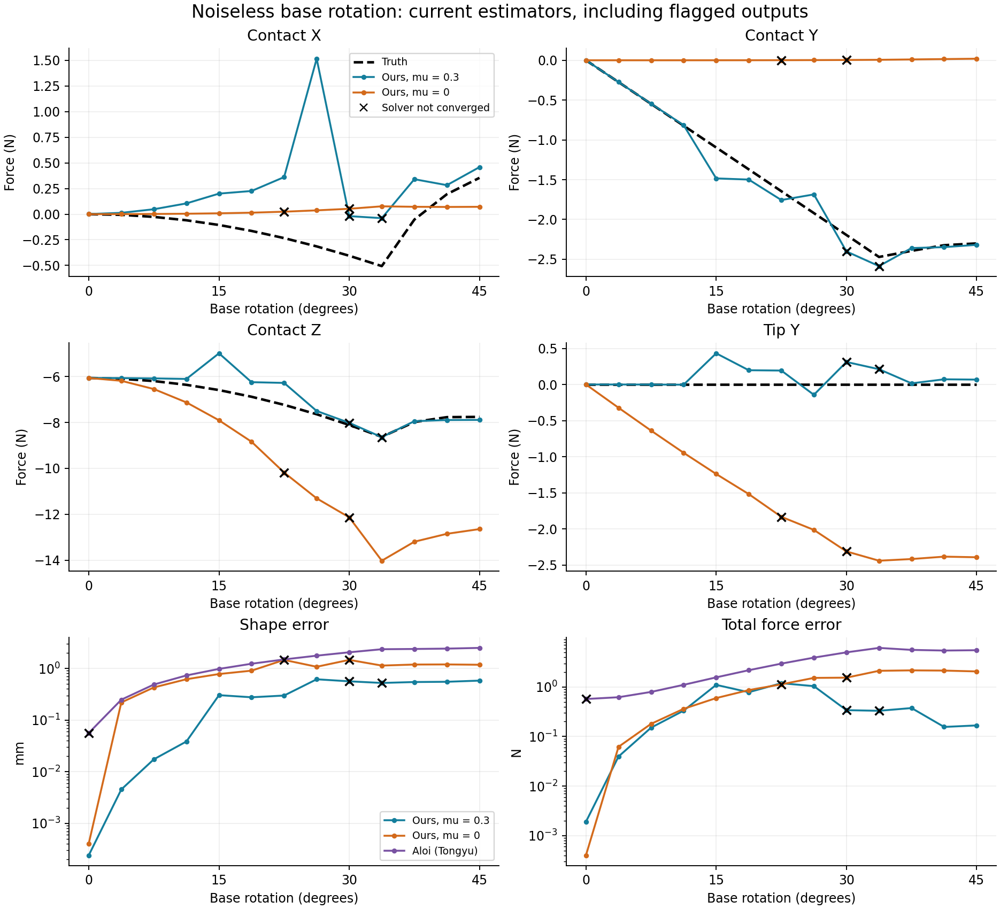
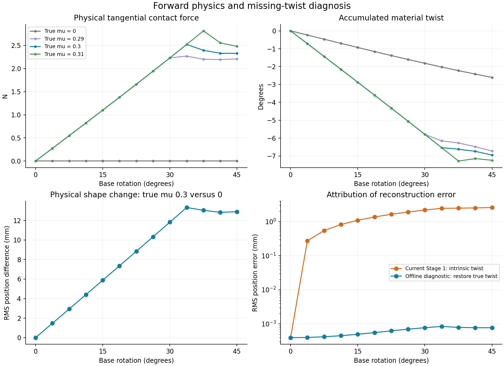
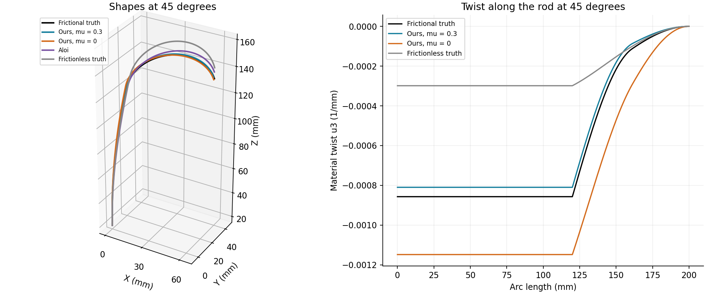

# Base rotation with centerline friction: current-method comparison

Date: 2026-10-06. Run `base_rotation_20261006`. Approved setup implemented separately from the earlier sliding experiment. No estimator physics or settings were changed; no commit or push was made.

## Main finding

Axial rotation of this precurved rod builds sticking friction and elastic material twist, then produces sliding. The correct friction model substantially improves contact/tip separation over mu=0, but the current two-stage estimator is less accurate and less reliable than in the planar sliding experiment. Stage 1 assumes intrinsic twist in an unmeasured channel, producing geometry bias even with perfect bending measurements. Correct friction alone cannot fix that reconstruction limitation.

| Method, all 13 frames including failures | Contact RMSE (N) | Tip RMSE (N) | Total-force RMSE (N) | Shape RMS (mm) |
|---|---:|---:|---:|---:|
| Ours, assumed mu=0.3 | 0.82485 | 0.61049 | 0.61205 | 0.40802 |
| Ours, assumed mu=0 | 3.81942 | 2.74808 | 1.39210 | 0.99875 |
| Tongyu Aloi | Not separated | Not separated | 3.79781 | 1.66607 |

Force RMSE pools squared three-dimensional error norm across frames; shape RMS pools squared position norm over all common nodes and frames. No failed or flagged estimate is excluded. Aloi estimates a single distributed Gaussian resultant, not separate contact and tip forces. Its position input is reconstructed from the same two bending channels, also with intrinsic twist assumed.



## Fixture, actuation and observations

The old sliding case had fixed base orientation, insertion 18 to 22 mm, X translation -0.5 mm per recorded frame and independently prescribed 0.02 mm sliding history pairs. This new case holds the base at [0,0,18] mm and rotates its material frame about world/local-base Z through 0:3.75:45 degrees. The plane remains at z=160 mm with normal [0,0,-1]; the applied tip force remains [1,0,-1] N in world coordinates. The 200 mm rod retains its 120 mm straight segment, 30 mm intrinsic bend radius, stiffness and 24 FBG locations.

Initialization is a rest equilibrium at 0 degrees with zero tangential preload, unlike the old sliding initial state. Frame-zero history repeats that same resting shape at an earlier timestamp. Subsequent history is the actual preceding state. The timestamps retain the current 0.02 s estimator reference interval; these are quasistatic equilibria, not an inertial simulation or validation at the implied actuation speed. Force application is at the centerline: friction opposes motion in the plane and is not constrained to the rod tangent. No finite-radius surface friction torque or contact-couple jump was added. Elastic twist follows u3 = u03 + (R-transpose m)3 / Kt; a spatial force can therefore induce twist through its moment arm without an applied contact couple.

Only two bending components are observed. No FBG/environment noise is injected, while the previous covariance floors and priors are retained (FBG std 1e-6/mm, environment position std 0.03 mm and normal component std 0.001). The third packet entry is intrinsic twist, not measured true twist. Our observation residual still selects only axes 1 and 2. Neither estimator receives reference forces, contact locations or true twist.

Current settings remain Stage 1 trust-region-reflective lsqnonlin (30 iterations, function/optimality/step tolerances 1e-8/1e-6/1e-8), and Stage 2 semismooth SQP (60 iterations, 300 trials, stationarity 1e-5; moment 1e-5 N mm, projection 1e-6 N, gap 1e-5 mm). IVP relative/absolute settings remain 2e-8/2e-10, with component scaling of absolute tolerances. Diagnostic sampling is 0.1 mm, optimization collision sampling 0.5 mm. Full options and source hashes are in metadata.json. Diagnosis remains reporting-only.

## Independent reference and actual friction behavior

The new contact wrapper directly calls Tongyu's unmodified solve_cosserat_multi_contact_map; it does not use our inverse IVP or optimizer to generate reference data. The wrapper solves contact arc and reaction using sticking/sliding branches, and validates the full disk projection, friction work, tangency, gap, nonpenetration and terminal moment. The initial planar solve only initializes the zero-angle equilibrium. Subsequent shapes are genuinely spatial, not rigid rotations of planar truth.

The first numerical attempts found nonphysical sliding roots with positive friction work; those were rejected. The final forward wrapper uses multiple angular starting guesses and accepts only roots passing the dissipative projection law and physical audit. Rejected attempts are retained in local logs/debug outputs and are not benchmark truth. Valid quasistatic roots do not establish global uniqueness or dynamic stability.

For true mu=0.3, the contact sticks through 33.75 degrees; first sampled sliding occurs at 37.50 degrees. The exact onset lies between these samples. At 45 degrees:

- Tangential friction magnitude: **2.32765 N**; normal force: **7.75885 N**.
- Contact force: [0.35420, -2.30055, -7.75885] N.
- Accumulated material twist, integral u3 ds: **-6.95154 degrees**, versus **-2.60633 degrees** for independently regenerated frictionless truth.
- Friction changes the true shape by **12.89487 mm RMS** and true tip position by [8.81098, -16.78769, 1.59183] mm, compared with frictionless physics at the same base angle.

The fixed world-frame tip force already generates some torsion when the rod rotates. The difference between physical mu=0.3 and mu=0 isolates friction's additional effect; total twist must not all be attributed to friction. Material twist is also distinct from geometric centerline torsion and is not simply base-angle minus tip-angle.

All 52 forward states (mu=0, 0.29, 0.3, 0.31) passed the audit. Maximum absolute gaps/tangency/penetration/projection/terminal moment are 4.66e-09 mm, 6.6e-12, 0 mm, 2.36e-12 N and 1.36e-09 N mm. Tightening reference ODE tolerance tenfold at the final state changes position by at most 6.23e-09 mm and curvature by 1.71e-13/mm. Full truth audits and reference_validation.json are retained.



## Estimator failure and geometry attribution

At 45 degrees, current Stage 1 position RMS error is **2.58813 mm**, contact-arc error is **0.31368 mm**, and normal-angle error is **0.33647 degrees**. The inferred Stage 1 geometry is identical for mu=0 and mu=0.3.

An offline diagnostic takes the same interpolated bending measurements and restores reference u3 only during reconstruction. Its final shape RMS error is **0.000770 mm**. This is a truth-assisted attribution check, not another estimator or a reported deployable result. It shows how much reconstruction error is due to missing twist, while preserving bending interpolation error. No reference twist was used in either comparison run.

At 45 degrees our correct-mu tip estimate is [0.87553, 0.06760, -0.70904] N, with 0.32360 N error. The zero-mu tip estimate is [0.85191, -2.39147, 1.87838] N, with 3.74515 N error. Tip Y is a prominent compensation channel when the tangential contact load is removed. Nonzero world X/Y contact components at assumed mu=0 can arise from the inferred normal tilt; physics.csv separately reports tangential force in the inferred contact basis.

Our converged counts are 11/13 at mu=0.3 and 11/13 at mu=0. Failed angles are [30.0, 33.75] and [22.5, 30.0] degrees respectively. A convergence flag is not a clean physical diagnostic: finer diagnosis detects penetration or tangency mismatch in some returned converged states. Maximum dense inferred-plane penetration is 0.000495/0.000670 mm (mu=0.3/0). Final correct-mu flags: `penetration;active-contact-tangency;fbg-mismatch;stage1-unobserved-twist`. Per-frame flags, model friction work, inferred contact work against true tangential motion, and all SQP iterations are preserved. The latter uses the inferred total contact force projected onto the true plane; a nonzero value at assumed mu=0 reflects the tilted estimated normal, not an added tangential force in the estimated contact basis. In all three truly sliding frames, the mu=0.3 contact load does negative work against the actual motion; the positive-friction-work flags at 30/33.75 degrees concern failed solves and their inferred history.

Correct-mu flag counts: {'stage1-unobserved-twist': 12, 'fbg-mismatch': 11, 'penetration': 4, 'active-contact-tangency': 6, 'mechanics-stagnation': 2, 'terminal-equilibrium': 2, 'contact-projection': 2, 'normal-complementarity': 2, 'positive-friction-work': 2}. Zero-mu flag counts: {'fbg-mismatch': 12, 'stage1-unobserved-twist': 12, 'active-contact-tangency': 9, 'penetration': 8, 'mechanics-iteration-limit': 2, 'terminal-equilibrium': 2, 'contact-projection': 1, 'normal-complementarity': 1}. Aloi returns 12/13 positive optimizer exit flags and 13/13 successful final equilibrium checks. These statuses are not force-accuracy certificates.



## Friction and force/deflection sensitivity

Two different experiments are kept separate:

1. **Forward physical sensitivity:** regenerate reference trajectories at true mu=0.29 and 0.31 with unchanged actuation and tip load. On the sticking branch, friction magnitude is set by equilibrium and kinematic sticking; mu only sets the allowable bound. Small mu changes therefore have virtually no effect while both trajectories remain stuck. Their first sampled sliding angles are 33.75 and 41.25 degrees. Near different transition angles, central differences span branches and are finite perturbations, not smooth derivatives.
2. **Inverse coefficient sensitivity:** replay the fixed true-mu=0.3 observations with assumed mu=0.29 and 0.31. These measure estimator/model sensitivity, including current geometry bias, history and stopping behavior. At the final frame, the finite dFtip/dmu is [0.6919, 4.4780, -5.9147] N per unit mu. Do not interpret these values as calibrated uncertainty, especially when a contributing solve does not converge; sensitivity.csv records both-converged status.

At 45 degrees, forward dFc/dmu is [-6.6615, -14.6290, -19.0652] N per unit mu. The forward shape-change norm is 76.0184 mm per unit mu, and accumulated-twist change is -25.9180 degrees per unit mu. These use the full sequential paths, not a single isolated equilibrium with its history reset.

The local observed-curvature Jacobian eliminates base moment through terminal equilibrium and uses physical world-force coordinates [tip XYZ, contact XYZ]. Its six-force condition numbers range 125.52-169.42. This diagnoses local force separation, not global identifiability; entries evaluated at failed estimates remain labelled with their convergence status. Full singular values, tip-Y/contact-Y correlations and constraint-tangent dimensions are in local_sensitivity.json. Geometry bias and weak load separation coexist here; the offline twist-restoration result directly exposes the former.

## Timing and numerical work

| Mean per frame | Ours mu=0.3 | Ours mu=0 | Aloi |
|---|---:|---:|---:|
| Full estimator seconds | 0.5159 | 0.5023 | 7.5764 |
| Geometry seconds | 0.1182 | 0.1078 | Not separated |
| Mechanics seconds | 0.3951 | 0.3922 | Not separated |
| SQP iterations | 18.15 | 20.08 | Not SQP |
| Full-rod IVP evaluations | 69.62 | 67.77 | No shooting IVP |
| Segmented ODE calls | 208.85 | 203.31 | Not this scheme |
| ODE RHS evaluations | 26970.2 | 26967.5 | Not comparable |
| Winning-start iterations | Not applicable | Not applicable | 18.46 |
| Shape integrations | Different scheme | Different scheme | 3004.69 |

Our timing is the second full replay; checked numerical outputs agree between repeats to 0. Aloi's unprofiled sequence takes 98.4930 s plus 0.0424 s reconstruction preparation. Its API does not expose per-frame times or summed iterations across both starts. Separate profiling counts 39061 shape integrations; profiled elapsed time 124.7390 s is excluded from the main timing comparison. Integration operations and warmup protocols differ; this is not a paper-level speedup claim. Aloi keeps the previous comparison's settings, including two starts, 25 maximum iterations, 180 evaluations, and 15 fixed-point updates with 0.001 mm tolerance. None of these estimator timings includes reference generation or sensitivity analysis.

## Reproduce and hand off

From two_stage_force_sensing, with the existing baseline dependency configured:

```matlab
setenv('TSFS_RUN_ID','base_rotation_20261006'); setup_tsfs;
build_rotation_truth(0.3);
run_rotation_comparison('ours');
run_rotation_comparison('aloi');
run_rotation_comparison('inverse');
run_rotation_comparison('forward');
run_rotation_comparison('profile');
analyze_rotation;
```

Then run `python experiments/base_rotation/summarize_rotation.py --run-id base_rotation_20261006`. Reference generation caches each coefficient's completed MAT file in the run directory; use a fresh base_rotation_ run ID for a new experiment. Large MAT files/logs remain local under ignored results/runs; compact evidence and plots are under results/published/base_rotation_20261006. The earlier single_contact_mu_20261006 outputs are preserved. The next scientific decision is how to handle unobserved twist in Stage 1; this work does not silently add twist sensing, a new objective, or a within-step correction loop.
